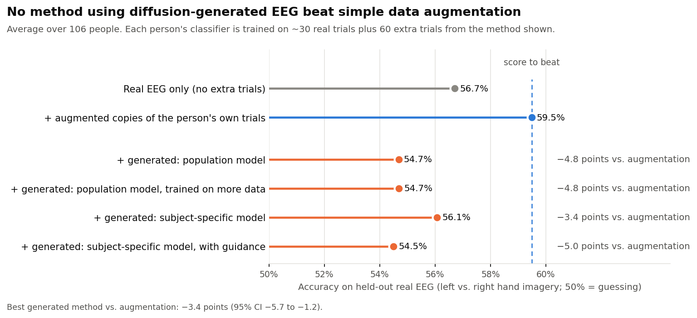
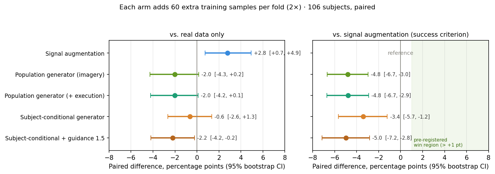
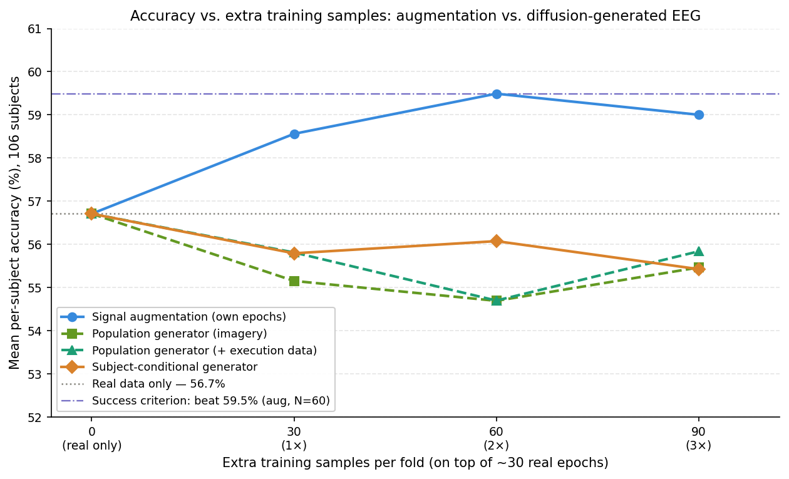
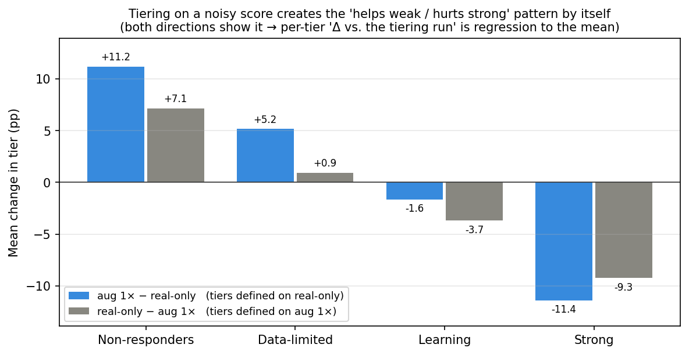

# NeuroSynth: Does diffusion-generated EEG beat signal augmentation for few-shot BCI calibration?

A brain-computer interface (BCI) has to be calibrated for each new user, who typically provides only
a few minutes of data. This project tests whether synthetic EEG from a diffusion model can stand in
for more calibration data. It is a controlled study on 106 subjects, designed so that a positive
result could not come from data leakage or from simply adding more training samples.

**Answer: no.** The best generator (subject-conditional diffusion) matches training on real data
alone but stays 3.4 points below plain signal augmentation. The study traces why.

**Outcome**

- **No generated-data method met the pre-registered criterion** (beat augmentation by > 1 point,
  p < 0.05). Augmentation reaches **59.5%**; the best generator reaches **56.1%**, a difference of
  −3.4 points (95% CI −5.7 to −1.2).
- **Realistic is not the same as useful.** The population generators match the real EEG spectrum
  and do not memorize their training data, yet they trail crude augmentation by ~5 points.
- **The missing ingredient is subject-specific.** Training the generator on cleaner data
  (motor-execution runs) changed nothing (+0.01). Conditioning on the subject was the only change
  that helped, recovering parity with real-only training.
- **The likely limit is real data per subject.** The learned subject embedding is used but only
  weakly subject-specific (~75 real epochs per subject), and amplifying it makes things worse.



*Each row adds a different kind of extra training data to the same ~30 real trials per person. The
dashed line is the score a generated-data method had to beat.*

---

## Contents

- [Research question](#research-question)
- [Data](#data)
- [Approach](#approach)
- [Results](#results)
- [Getting to a trustworthy pipeline](#getting-to-a-trustworthy-pipeline)
- [Interpretation](#interpretation)
- [Limitations](#limitations)
- [Future work](#future-work)
- [Reproducing the results](#reproducing-the-results)
- [Repository structure](#repository-structure)
- [Research log](#research-log)
- [References](#references)

## Research question

> Does adding synthetic EEG to a subject's small real training set improve a within-subject
> motor-imagery classifier **more than adding the same number of signal-augmented copies** of that
> subject's own data?

The comparison is against augmentation, not against real data alone, because cheap augmentation
(noise, time shift, channel dropout, cropping) is the baseline any generative model must justify its
cost against.

**Success criterion (RR-3)**, fixed in [`specs/`](specs/README.md) before the generator runs: at 60 extra
samples per fold, mean per-subject accuracy must exceed the augmentation arm by **more than 1
percentage point**, with a one-sided paired Wilcoxon test **p < 0.05** across subjects.

## Data

PhysioNet EEG Motor Movement/Imagery dataset (Schalk et al. 2004); see [`data/`](data/README.md).

| | |
|---|---|
| Subjects | 106 (of 109; three with non-standard epoch lengths dropped) |
| Task | imagined left- vs right-fist movement, runs 4, 8, 12 |
| Recording | 64 EEG channels, 160 Hz |
| Preprocessing | 7–30 Hz band-pass, epochs −1 to +4 s (801 samples), per-epoch per-channel z-score |
| Size | 4,748 epochs, about 15 per run and 45 per subject |
| Extra generator data (one arm) | motor-*execution* runs 3, 7, 11 of the same subjects (~4.75k epochs) |

## Approach

**Classifier.** EEGNet (Lawhern et al. 2018; 2,930 parameters), trained from scratch for every fold:
full-batch Adam, learning rate 1e-3 with cosine decay to 1e-5, 500 epochs, no early stopping.

**Protocol: within-subject leave-one-run-out.** Each subject has three runs. Each fold trains on two
runs (~30 epochs) and tests on the held-out third (~15 epochs), giving 318 folds. A subject's accuracy
is the mean of its three folds; the cohort score is the mean over subjects. Holding out whole runs
avoids leakage between temporally adjacent trials.

**Sample-matched comparison.** Every arm adds *N* ∈ {30, 60, 90} extra class-balanced samples (1×, 2×,
3× the real set) to the same real training set; only their source differs. Online augmentation, which
keeps the set at 30 samples, was run but rejected as a baseline for this reason.

**Generators.** Class-conditional 1D U-Net DDPMs (~20 M parameters, cosine schedule, classifier-free
guidance, 50-step DDIM sampling), trained on Modal A10G GPUs for 100k steps.

| Arm | Generator trained on | Conditioning |
|---|---|---|
| Population (imagery) | 2 of 3 imagery runs, all subjects (~3.2k epochs) | class |
| Population (+ execution) | the above + all motor-execution runs (~7.9k epochs) | class, domain (sampled as imagery) |
| Subject-conditional | as above | class, domain, **subject embedding** |
| Subject-conditional + guidance | same model, sampling pushed toward the subject (scale 1.5) | as above |

The subject embedding is trained as a residual over a population fallback: with probability 0.15 the
subject token is replaced by a null token, so the shared network learns the population and each
embedding only encodes the subject's offset.

**Leakage control: run-holdout cross-fitting.** Three generators are trained per arm, each with one
imagery run (4, 8 or 12) removed **for every subject**. A fold that tests on run *R* may only draw from
the generator that never saw run *R*, and for subject-conditional data only from its own subject's
bank. Assertions enforce both at the point where synthetic data is loaded, and
[`tests/test_leakage.py`](tests/test_leakage.py) checks them. Every subject can therefore be evaluated
without leakage, at full statistical power.

**Statistics.** All comparisons are paired over the 106 subjects: mean difference with a 95%
percentile bootstrap CI (10,000 resamples of subjects) and a two-sided Wilcoxon signed-rank test. The
success criterion uses the pre-registered one-sided test.

## Results

### 1. Main comparison

At 60 extra samples per fold, the pre-registered comparison point
([`results/summary.csv`](results/summary.csv)):

| Arm | Accuracy | Δ vs real only [95% CI] | Δ vs augmentation [95% CI] | Criterion |
|---|---|---|---|---|
| Real data only | 56.7% | — | −2.8 [−4.9, −0.7] | — |
| **Signal augmentation** | **59.5%** | **+2.8 [+0.7, +4.9]** | — | reference |
| Population generator (imagery) | 54.7% | −2.0 [−4.3, +0.2] | −4.8 [−6.7, −3.0] | fail |
| Population generator (+ execution) | 54.7% | −2.0 [−4.2, +0.1] | −4.8 [−6.7, −2.9] | fail |
| Subject-conditional generator | 56.1% | −0.6 [−2.6, +1.3] | −3.4 [−5.7, −1.2] | fail |
| Subject-conditional + guidance 1.5 | 54.5% | −2.2 [−4.2, −0.2] | −5.0 [−7.2, −2.8] | fail |



- **Augmentation helps** (+2.8 over real-only, CI excludes zero). Every generator falls short of it,
  with CIs entirely below zero.
- **Population generators trend below real-only training** (−2.0, CI just crosses zero): their
  extra data is, if anything, slightly harmful.
- **The subject-conditional generator is the only one at real-only parity** (−0.6, CI −2.6 to +1.3).



The ordering holds at every amount of extra data. Augmentation peaks at 2× and dips at 3×; no
synthetic arm reaches the real-only score at any *N* (best: 56.1%).

### 2. Comparisons between generators

| Comparison | Δ [95% CI] | two-sided p |
|---|---|---|
| + execution data vs. imagery-only population | +0.01 [−1.8, +1.8] | 0.77 |
| Subject-conditional vs. population (imagery) | +1.4 [−0.5, +3.3] | 0.12 |
| Subject-conditional vs. population (+ execution) | +1.4 [−0.7, +3.5] | 0.21 |
| Adding subject guidance (scale 1.5) | −1.6 [−2.9, −0.3] | 0.02 |

All comparisons, with subjects better/worse: [`results/paired_comparisons.csv`](results/paired_comparisons.csv).

- **More and cleaner population data does nothing.** Adding motor-execution data, with a high
  signal-to-noise ratio and the same left/right classes, leaves accuracy exactly unchanged.
- **Subject conditioning is a positive trend**, not a significant gain, over the population arms.
- **Guidance hurts** (the one significant difference among the generators).

### 3. Is the subject embedding actually used?

A probe ([`src/neurosynth/probe_subject_embedding.py`](src/neurosynth/probe_subject_embedding.py)) rules out the
generator ignoring its subject token.

- **It is used.** With noise, class and domain held fixed, swapping the subject token moves the
  output by 25% of the distance between two independent samples.
- **It is only weakly subject-specific.** Each subject's generated spectrum is closer to its own real
  spectrum than to others' (0.095 vs 0.153), but its own subject is the nearest match for only 33% of
  subjects, about twice chance.
- **Sharpening does not help.** Guidance on the subject token raised specificity slightly up to a
  scale of 1.5 while fidelity fell steadily (scales 0–5 swept). At 1.5 it lowered downstream accuracy.

### 4. Which subjects lose most, and a selection-bias check

Subjects were grouped by real-only accuracy: Non-responders (< 45%, n = 14), Data-limited (45–56%,
n = 41), Learning (56–70%, n = 42) and Strong (> 70%, n = 9).

**Change relative to the run that defines the tiers is biased.** Tiers chosen on a noisy score (15
test trials per fold) put lucky subjects in the top tier and unlucky ones in the bottom, so *any*
other run regresses toward the mean. The effect is large. Tiered on real-only accuracy, augmentation
(1×) appears to add +11.2 for Non-responders and −11.4 for Strong subjects; tiered on augmentation
instead, *real-only* appears to "help" Non-responders (+7.1) and "hurt" Strong subjects (−9.3).



**Comparing two arms within a tier is not biased**, because neither defines the tiers
([`results/tier_comparisons.csv`](results/tier_comparisons.csv)):

| Tier (n) | Population − augmentation | Subject-cond. − augmentation | Subject-cond. − population |
|---|---|---|---|
| Non-responders (14) | −0.5 [−4.5, +4.0] | +2.3 [−1.7, +6.8] | +2.8 [+0.7, +4.9] |
| Data-limited (41) | −4.6 [−7.8, −1.3] | −5.3 [−9.2, −1.7] | −0.7 [−3.4, +1.8] |
| Learning (42) | −5.2 [−7.9, −2.4] | −3.1 [−6.6, +0.1] | +2.0 [−1.3, +5.2] |
| Strong (9) | −10.6 [−16.5, −4.9] | −4.9 [−14.8, +4.0] | +5.7 [−3.7, +15.6] |

- **The population generator's deficit grows with how learnable the subject is** (−0.5 → −10.6 vs
  augmentation): it hurts most where the classifier relies on a subject-specific pattern.
- **Subject conditioning narrows the gap**, most clearly for Non-responders; its Strong-tier gain is
  large but uncertain with n = 9.
- **No tier is won against augmentation**, and the data-limited tier, where augmentation helps
  most, is not helped by any generator.

## Getting to a trustworthy pipeline

**Baseline.** Getting a sound real-only baseline took six iterations
([research log](reports/phase0_baseline_report.md), §5):

| Attempt | Accuracy | What it showed |
|---|---|---|
| Cross-subject EEGNet (3 training-loop variants) | 50–52% | One model across subjects converges to a compromise: subject-specific spatial filters cancel out |
| + Euclidean alignment | ~50% | Whitening removes the inter-channel structure that carries the within-subject signal |
| Within-subject, early stopping on 6 validation trials | 54.1% | 63% of folds stuck near chance: noisy checkpoint selection and 8-sample BatchNorm batches |
| Within-subject, full batch, fixed epochs | **56.7%** | Final real-only baseline |

The 56.7% is lower than commonly quoted motor-imagery accuracies. The protocol is deliberately
strict: imagery runs only, ~30 training trials, no transfer from other subjects, and every subject
included. EEGNet was not originally benchmarked on this dataset, so there is no directly comparable
published number.

**Generator.** The first samples had a standard deviation of ~675 instead of 1, although training
loss was healthy. The fault was in sampling: without clamping the predicted clean signal, the DDIM step
divides by √ᾱₜ ≈ 5×10⁻⁵ near t = T and amplifies errors ~20,000×. Clamping to ±4 (the range of 99.9% of
real values) plus re-z-scoring fixed it without retraining. Afterwards the synthetic spectrum matches
the real one across 8–30 Hz. Memorization check: generated samples are no closer to their nearest
training sample (~296) than real samples are to each other (~290).

**Analysis.** A final review of my own reports found that the tier-level claims were inflated by
regression to the mean and that some trends had been called significant. The reports carry dated
review notes; the numbers in this README come with bootstrap CIs computed from `results/`.

## Interpretation

1. **Spectral fidelity is not usefulness.** The population generators were spectrally faithful and
   non-memorizing, yet trailed augmentation by ~5 points. Augmentation's samples are less realistic,
   but they keep the subject's own spatial structure.
2. **The missing ingredient is subject-specific.** Better population data changed nothing; subject
   conditioning is the only change that moved results toward real-only and augmentation; and within
   tiers, the population deficit is largest where the classifier has learned the most
   subject-specific structure. This fits the EEGNet design, where the spatial filter is inherently
   per-subject.
3. **The likely limit is real data per subject.** With ~75 real epochs per subject, the embedding is
   only weakly specific, and amplifying it hurts. This is the most plausible explanation for the
   remaining gap, but it was **not tested directly** (see [Future work](#future-work)).

## Limitations

- **One seed.** Every arm was trained once (seed 42). The CIs cover subject sampling, not training
  randomness, so differences of ~1 point should be read with caution.
- **Coarse per-fold accuracy.** Test folds have 15 trials, so per-fold accuracy moves in 6.7-point
  steps and per-subject accuracy in ~2.2-point steps. Individual-subject results are noisy.
- **One dataset, one classifier, one task.** The conclusions may not transfer to other paradigms,
  montages or classifiers.
- **One generator family and size**, with no hyperparameter search, because cloud compute was limited
  (under $50 in total).
- **The embedding probe is channel-averaged**, so it under-tests spatial topography.
- **Multiple comparisons.** Only the pre-registered comparison against augmentation at 60 extra
  samples is confirmatory; the rest is exploratory.

## Future work

In rough order of information per unit of effort:

1. **Seed replicates** of real-only, augmentation 2× and subject-conditional 2×, to measure training
   variance. Cheap and local.
2. **Hybrid arm**: real + augmentation + subject-conditional synthetic. The per-tier results suggest
   they help different subjects. Uses cached synthetic banks, no retraining.
3. **Data-scaling curve**: vary real trials per subject (15 / 30 / 45 via run subsets) to find where
   synthetic data starts to help, if it does. This directly tests the explanation above.
4. **Pooled-real upper bound**: add *real* epochs from other subjects instead of synthetic ones. If
   even real population data does not help, no population generator can.
5. **Information-adding conditioning**: condition on the subject's spatial covariance or its
   nearest-neighbour subjects instead of a free embedding.
6. **Second dataset** (BCI Competition IV-2a) and a second classifier.

## Reproducing the results

```bash
python3 -m venv .venv && source .venv/bin/activate
make install                  # pip install -r requirements.txt && pip install -e .
python scripts/check_environment.py

make test                     # leakage-invariant tests (seconds)
make figures                  # every figure and table, rebuilt from results/per_subject/ (seconds, no GPU)
```

`make figures` is deterministic: with the versions in `requirements.txt` (Python 3.9), rerunning produces
byte-identical files. Newer scipy versions change some Wilcoxon p-values in the third decimal. The numbers in the tables
above come from `results/*.csv`. The only figures not rebuilt from `results/` are the three
`reports/figures/diffusion_fidelity_run*.png` plots, which generator training writes.

Full pipeline (the dataset is downloaded via MNE):

```bash
python scripts/build_dataset.py --subjects $(seq 1 109) --task imagery_lr --out data/processed.npz
python scripts/train_classifier.py --data data/processed.npz --run vanilla
python scripts/train_classifier.py --data data/processed.npz --run augmented_offline --n-copies 2
modal run --detach cloud/modal_train_diffusion.py          # generators on GPU; see cloud/README.md
modal run --detach cloud/modal_train_tstr.py --variant imagery
make collect figures          # copy the new result files into results/ and redraw everything
```

Baselines run locally on Apple Silicon (~2.5 h per arm); each set of three generators takes ~3 h on
Modal A10G GPUs. Results were produced with the exact versions in `requirements.txt` (Python 3.9).

## Repository structure

```
data/                     dataset notes (see data/README.md); the .npz files are built locally
src/neurosynth/
  config.py               paths and constants (runs, tiers, seed)
  data.py                 EEGBCI download, band-pass, epoching, z-scoring -> .npz
  dataset.py              within-subject leave-one-run-out splits
  augmentations.py        noise / time shift / channel dropout / crop
  eegnet.py               EEGNet classifier
  train_baseline.py       per-fold training: real-only, augmented, synthetic (+ leakage guards)
  diffusion.py            1D U-Net DDPM with class / domain / subject conditioning, DDIM + guidance
  train_diffusion.py      generator training, fidelity and memorization checks, synthetic banks
  probe_subject_embedding.py  is the subject embedding used, and is it subject-specific?
scripts/
  build_dataset.py        dataset
  train_classifier.py     classifier experiments (all arms)
  train_generator.py      generator training (local; cloud/ for GPU)
  make_figures.py         every figure and table (runs the three scripts below)
  analyze_results.py      results/*.csv, README figures
  compare_baselines.py    gate verdicts, research-log figures fig10–fig14
  report_figures.py       research-log figures fig1–fig9
cloud/                    Modal GPU launchers for generators and synthetic-data runs
results/                  summary tables (CSV); per_subject/ holds the raw outcome of every run
figures/                  README figures
reports/                  research log: one report per stage, plus its figures
specs/                    design documents, each written before its experiment
tests/                    leakage-invariant tests
```

## Research log

The full record of how the project developed is in [`reports/`](reports/README.md) (one report per
stage, with dated review notes) and [`specs/`](specs/README.md) (the design written before each
experiment, including the alternatives considered and the decision rule).

## References

- Schalk, G. et al. (2004). BCI2000: a general-purpose brain-computer interface system. *IEEE TBME* 51(6).
- Goldberger, A. L. et al. (2000). PhysioBank, PhysioToolkit, and PhysioNet. *Circulation* 101(23).
- Lawhern, V. J. et al. (2018). EEGNet: a compact convolutional neural network for EEG-based BCIs. *J. Neural Eng.* 15(5).
- He, H. & Wu, D. (2019). Transfer learning for BCIs: a Euclidean space data alignment approach. *IEEE TNNLS*.
- Ho, J., Jain, A. & Abbeel, P. (2020). Denoising diffusion probabilistic models. *NeurIPS*.
- Nichol, A. & Dhariwal, P. (2021). Improved denoising diffusion probabilistic models. *ICML*.
- Song, J., Meng, C. & Ermon, S. (2021). Denoising diffusion implicit models. *ICLR*.
- Ho, J. & Salimans, T. (2022). Classifier-free diffusion guidance. *NeurIPS Workshop*.
- Carlini, N. et al. (2023). Extracting training data from diffusion models. *USENIX Security*.
- Vidaurre, C. & Blankertz, B. (2010). Towards a cure for BCI illiteracy. *Brain Topography* 23(2).

---

**License:** MIT, see [LICENSE](LICENSE). Data: [PhysioNet EEG Motor Movement/Imagery Dataset](https://physionet.org/content/eegmmidb/1.0.0/) (ODC-By 1.0).

**Author:** Valerie Salivon
