# NeuroSynth: Phase 0 — EEGNet Baseline Evaluation Report

**Project:** NeuroSynth — Synthetic EEG Data Platform  
**Phase:** 0 — Baseline Establishment  
**Experiments:** Cross-subject attempts → vanilla baseline → augmented baseline → population diffusion model  
**Date:** 2026-06-28 (updated 2026-07-06)  
**Status:** Vanilla baseline complete (56.7%). Additive augmented baseline complete (best: 59.5% ± 11.2% at 2×). Diffusion model (Step 4) trained and validated — three run-holdout DDPMs. **TSTR gate (Step 5): RR-3 FAILED** — population imagery synthetic scores 54.7% at N=60, below both the augmented ceiling (59.5%) and vanilla (56.7%); harm in the Learning/Strong tiers (spatial-filter dilution). **Pivot 1 (execution-conditioned generator): ALSO FAILED** — enriching the generator with real motor-execution data gave 54.7% (zero lift over imagery, +0.01%, p=0.62), proving the bottleneck is subject-agnostic population averaging, not data quality/domain. **Decision: subject-conditional generation (Pivot 2).** See `reports/phase0_tstr_report.md` and `reports/pivot_iter01_exec_conditioned_tstr_report.md`.

---

## Abstract

This report documents all steps taken during Phase 0 of the NeuroSynth project to establish a reproducible EEG motor imagery classification baseline using EEGNet on the PhysioNet EEGBCI dataset. Six experiments were conducted, progressively diagnosing and correcting failures in evaluation protocol, preprocessing, and training loop design. The vanilla baseline achieves **56.7% ± 10.8%** mean per-subject accuracy using within-subject Leave-One-Run-Out (LORO) evaluation with no data augmentation. Subsequently, an additive augmented baseline was established by pre-generating N augmented copies per training fold and appending them to the real data. The augmented ceiling is **59.5% ± 11.2%** at 2× (N=60 extra samples, 90 total per fold). These two numbers — 56.7% and 59.5% — serve as the reference points for the Train-on-Synthetic, Test-on-Real (TSTR) comparison that is the central go/no-go gate for the project. This iteration also completes Phase 0 Step 4: three population diffusion models (1D U-Net DDPM, ~20M parameters each) were trained on Modal under a leave-one-run-out cross-fitting protocol that keeps the downstream gate leakage-free. Their initial samples were unusable due to a DDIM sampler stability bug, which was diagnosed and fixed (predicted-signal clamping plus z-score normalization); the corrected generators produce spectrally faithful, non-memorizing, mutually comparable output and are ready for the TSTR evaluation in Step 5.

---

## 1. Project Context

### 1.1 NeuroSynth Overview

NeuroSynth is a platform for generating synthetic EEG data to augment small real-world BCI calibration datasets. The core commercial hypothesis is: a BCI company onboarding a new user has only 5–10 minutes of calibration data, which is insufficient to train a reliable personal classifier. By purchasing synthetic EEG generated by a population-level generative model, they can augment this calibration set and achieve better accuracy without collecting more real data.

The generative model is a diffusion model trained on EEG data from many subjects. It produces label-conditioned synthetic epochs — realistic-looking EEG time series with a known class label (e.g., "left fist motor imagery") — sampled from the population distribution.

### 1.2 The TSTR Test

The go/no-go evaluation is a **Train-on-Synthetic, Test-on-Real (TSTR)** comparison:

```
Baseline:  train EEGNet on real data only         → accuracy_real
Augmented: train EEGNet on real + augmented data  → accuracy_augmented
TSTR:      train EEGNet on real + synthetic data  → accuracy_synthetic

Go criterion: accuracy_synthetic > accuracy_augmented (by a meaningful margin)
```

If synthetic data cannot beat naive signal augmentation (Gaussian noise, time-shifting, etc.), the generative model provides no practical value. Phase 0 establishes `accuracy_real` and `accuracy_augmented` as the two reference points. TSTR training and evaluation come in Phase 0 Step 5, after the diffusion model is trained in Step 4.

### 1.3 Phase 0 Goals

1. Implement a clean, reproducible EEGNet training pipeline on PhysioNet EEGBCI.
2. Establish `vanilla` baseline: real data, no augmentation.
3. Establish `augmented` baseline: real data + standard signal augmentation.
4. These two numbers become the go/no-go comparison targets.

---

## 2. Dataset: PhysioNet EEGBCI

### 2.1 Source

**PhysioNet EEG Motor Movement/Imagery Dataset** (Schalk et al. 2004, Goldberger et al. 2000).  
Available via the MNE Python library (`mne.datasets.eegbci`).

- **109 subjects** (106 usable after dropping subjects 88, 92, 100 which have non-standard epoch lengths)
- **64 EEG channels** in 10-05 standard montage
- **Sampling rate:** 160 Hz
- **14 runs per subject** covering rest, motor execution, and motor imagery tasks

### 2.2 Task Selection

We use the **left fist vs. right fist motor imagery** task (`imagery_lr`), which uses runs 4, 8, and 12 per subject. Each run contains approximately 15 annotated T1 (left fist) and T2 (right fist) events.

- **Runs 4, 8, 12:** Imagine left fist (T1) vs. right fist (T2)
- **T0 (rest)** events are discarded — this is a binary discrimination task

This task was chosen because:
- It is the standard EEGBCI benchmark in the motor imagery BCI literature
- Left/right lateralized ERD (event-related desynchronization) over C3/C4 is well-characterized
- It directly maps to the BCI product use case (left/right hand intent decoding)

**Execution runs (3, 7, 11) were deliberately excluded** from training. While they contain stronger, more reliable ERD signal, including them would contradict the product story: users with motor disabilities (the primary BCI target population) cannot produce motor execution data. The baseline must use imagery-only data to be a fair model of the deployment scenario.

### 2.3 Preprocessing Pipeline

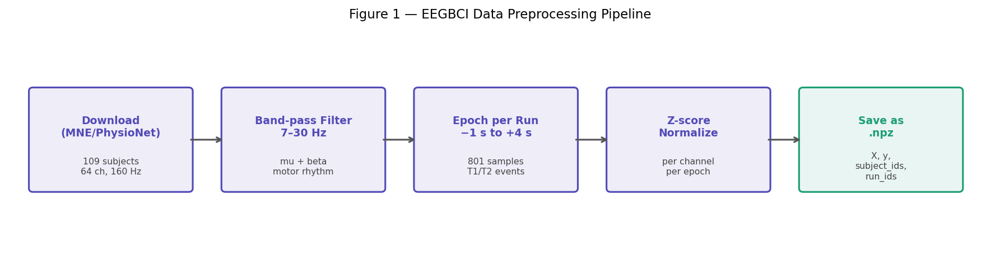

The full pipeline, implemented in `data/eegbci_pipeline.py`:

**Step 1 — Download:** Raw EDF files fetched via `mne.datasets.eegbci.load_data()`. Channel names standardized to 10-05 standard using `eegbci.standardize()` and `make_standard_montage("standard_1005")`.

**Step 2 — Band-pass filter:** Applied using a FIR filter in the mu + beta motor imagery band:
```python
raw.filter(7.0, 30.0, fir_design="firwin", verbose="ERROR")
```
The 7–30 Hz band captures both the mu rhythm (8–12 Hz, resting-state motor cortex) and the beta rhythm (13–30 Hz, active motor suppression). ERD during motor imagery manifests as a reduction in power in this band over the contralateral motor cortex.

**Step 3 — Epoch extraction (per run):** Each run is processed individually. Epochs are extracted around T1/T2 event markers with a window of −1 s to +4 s (baseline: none). This gives **801 time samples per epoch** at 160 Hz.

```python
epochs = mne.Epochs(raw, events, event_id=wanted,
                    tmin=-1.0, tmax=4.0, baseline=None, preload=True)
```

The −1 s pre-stimulus period captures baseline EEG. The 4 s post-stimulus period covers the full motor imagery task window.

**Step 4 — Z-score normalization:** Each epoch is normalized independently, per channel:
```python
def zscore_normalize(X: np.ndarray) -> np.ndarray:
    mean = X.mean(axis=-1, keepdims=True)   # shape: (N, C, 1)
    std  = X.std(axis=-1, keepdims=True)
    std[std == 0] = 1.0
    return (X - mean) / std
```
This removes DC offsets and per-channel amplitude differences without altering temporal dynamics or inter-channel spatial correlations.

**Step 5 — Save:** All epochs concatenated and saved as a compressed NumPy archive:
```
X:           (4748, 64, 801)  float32
y:           (4748,)          int64   (0 = left fist, 1 = right fist)
subject_ids: (4748,)          int64
run_ids:     (4748,)          int64   (4, 8, or 12)
ch_names:    (64,)            str
sfreq:       160.0
```

### 2.4 Dataset Statistics

| Property | Value |
|---|---|
| Total epochs | 4,748 |
| Usable subjects | 106 |
| Dropped subjects | 88, 92, 100 (non-standard epoch length) |
| Epochs per subject (approx.) | ~45 (15 per run × 3 runs) |
| Class balance | [2396 left, 2352 right] — nearly balanced |
| Epoch length | 801 samples (5 s at 160 Hz) |
| Runs per subject | 3 (runs 4, 8, 12) |
| Epochs per fold (approx.) | 30 train, 15 test |

---

## 3. Model Architecture: EEGNet

### 3.1 Overview

**EEGNet** (Lawhern et al. 2018, DOI: 10.1088/1741-2552/aace8c) is a compact, depthwise separable CNN designed specifically for EEG signal classification. It was chosen because:

- It is the **de facto standard baseline model** for EEG motor imagery benchmarks
- With only **2,930 parameters**, it is designed to train on small datasets without overfitting
- Its architecture is **interpretable**: each block has a clear neurophysiological meaning
- It is **well-calibrated for this dataset**: the original paper reports 65–80% within-subject on EEGBCI motor imagery

### 3.2 Architecture

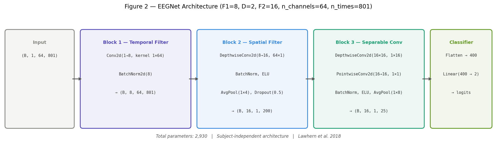

Input shape: **(B, 1, 64, 801)** — batch × channel × EEG channels × time samples

**Block 1 — Temporal Filter:**
```python
Conv2d(1, F1=8, kernel_size=(1, 64), padding=(0, 32), bias=False)
BatchNorm2d(8)
```
Learns F1=8 temporal filters, each spanning 64 samples (400 ms at 160 Hz). This is equivalent to bandpass filtering at multiple sub-bands within the 7–30 Hz range. Each filter learns to emphasize different temporal features of the motor imagery signal.

**Block 2 — Depthwise Spatial Filter:**
```python
Conv2d(F1=8, F1*D=16, kernel_size=(64, 1), groups=F1, bias=False)
BatchNorm2d(16)
ELU()
AvgPool2d(kernel_size=(1, 4))
Dropout(p=0.5)
```
The critical block. For each temporal filter from Block 1, learns D=2 spatial filters — linear weightings across all 64 electrodes. This is equivalent to a learned spatial beamformer (EEG source separation). The (64, 1) kernel means each filter looks at all channels simultaneously for a single time point. **This block's weights are subject-specific**: they encode which electrode combination best captures this person's motor cortex.

**Block 3 — Separable Convolution:**
```python
Conv2d(16, 16, kernel_size=(1, 16), padding=(0, 8), groups=16, bias=False)  # depthwise
Conv2d(16, F2=16, kernel_size=(1, 1), bias=False)                             # pointwise
BatchNorm2d(16)
ELU()
AvgPool2d(kernel_size=(1, 8))
Dropout(p=0.5)
```
Learns temporal-spectral patterns in the spatially-filtered signal from Block 2. The depthwise step processes each spatial filter independently; the pointwise step learns to combine them. After pooling, the temporal dimension reduces from ~200 to ~25.

**Classifier:**
```python
Flatten → Linear(400, 2)  # 16 filters × 25 time points = 400 features
```
A single linear layer maps the learned features to class logits.

**Weight Constraints (per paper):**
```python
def apply_weight_constraints(self, max_norm_conv=1.0, max_norm_fc=0.25):
    # Clip conv weight norms to max_norm_conv
    # Clip linear weight norms to max_norm_fc
```
The max-norm constraint on the FC layer (0.25) is the most critical regularizer for small datasets: it prevents the classifier from memorizing training examples through large weight magnitudes.

### 3.3 Parameter Count

| Component | Parameters |
|---|---|
| Block 1 (Conv2d + BN) | 8×64 + 8×2 = 528 |
| Block 2 (DepthwiseConv + BN) | 8×64 + 16×2 = 544 |
| Block 3 (Separable + BN) | 16×16 + 16×16 + 16×2 = 544 |
| Classifier (Linear) | 400×2 + 2 = 802 |
| **Total** | **~2,930** |

With 30 training samples per fold, the samples-to-parameters ratio is approximately **0.010** (30/2930) — severely data-limited by any standard. EEGNet was specifically designed to operate in this regime; larger models would overfit catastrophically.

---

## 4. Evaluation Protocol Design

### 4.1 Initial Approach: Cross-Subject Evaluation (4 iterations)

The initial evaluation protocol assigned whole subjects to train, validation, and test splits. With 106 subjects, a 70/15/15 split gives approximately 74 train subjects, 16 validation, 16 test.

```python
def subject_stratified_split(X, y, subject_ids, val_frac=0.15, test_frac=0.15, seed=42):
    """Assign whole subjects to train/val/test — no subject appears in more than one split."""
```

This cross-subject protocol trains a single EEGNet on all training subjects' data and evaluates on held-out test subjects. The motivation was to evaluate whether a population-level generative model's output could train a subject-agnostic classifier.

This approach ultimately failed (see Section 5) and was replaced.

### 4.2 Leave-One-Run-Out (LORO) Evaluation

The within-subject LORO protocol trains a separate EEGNet for each (subject, held-out-run) combination:

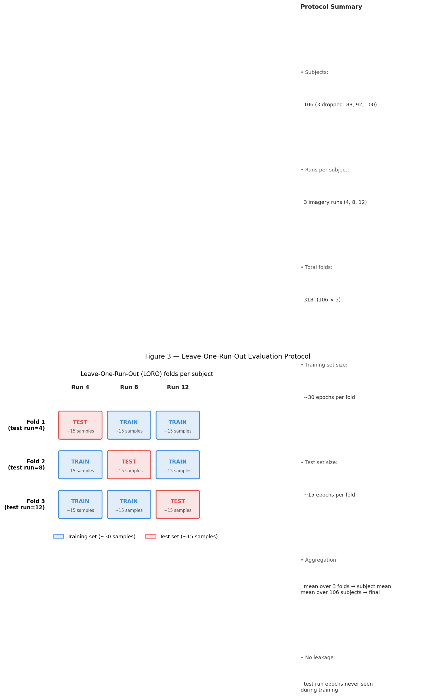

```python
def within_subject_loro_split(X, y, subject_ids, run_ids) -> list[dict]:
    """For each subject × held-out run, returns train/test splits."""
    for subject in unique(subject_ids):
        for test_run in unique(run_ids[subject_mask]):
            train_mask = run_ids != test_run
            test_mask  = run_ids == test_run
            yield {
                "subject": subject, "test_run": test_run,
                "X_train": X[train_mask], "y_train": y[train_mask],
                "X_test":  X[test_mask],  "y_test":  y[test_mask],
            }
```

- **3 folds per subject** (one held-out run each time)
- **106 subjects × 3 folds = 318 total training/evaluation runs**
- **~30 training samples** per fold (15 epochs × 2 runs)
- **~15 test samples** per fold (15 epochs × 1 run)

Per-fold accuracy is averaged across 3 folds to get a per-subject accuracy. Per-subject accuracies are averaged across all 106 subjects for the final reported number. This is the standard evaluation protocol for EEGBCI motor imagery in the literature.

**Why not simple k-fold?** Epochs within the same experimental run are temporally correlated (same recording session, same electrode impedances, same subject state). Simple epoch shuffling and splitting within a run creates temporal leakage: adjacent epochs from the same trial can end up on opposite sides of the train/test boundary, artificially inflating accuracy. LORO respects the run boundary, which represents a genuinely independent recording session.

**Why 3 folds rather than more?** EEGBCI `imagery_lr` provides exactly 3 imagery runs per subject. LORO is the only natural split that respects the run boundary. Adding more folds would require either splitting within runs (introducing leakage) or using fewer training samples (reducing reliability).

---

## 5. Experiment Log

All experiments are summarized in the figure below:

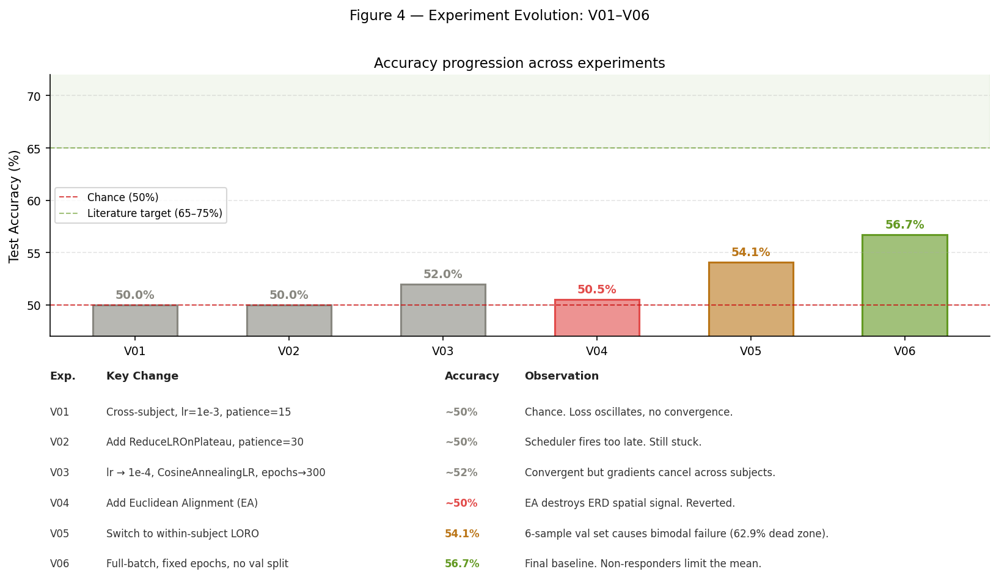

### 5.1 Initial Cross-Subject Implementation

**Goal:** Establish the first working EEGNet baseline.

**Setup:**
- Cross-subject stratified split (74 train / 16 val / 16 test subjects)
- Adam optimizer, lr=1e-3, weight_decay=1e-4
- CrossEntropyLoss
- Early stopping: patience=15 epochs on val loss
- max_epochs=200, batch_size=64
- Dropout=0.5, max_norm_fc=0.25

**Result:** ~50% accuracy (chance level)

**Observation:** Training loss oscillated around log(2) ≈ 0.693 and never converged. Loss would bounce between 0.6911 and 0.6929 between consecutive epochs with no monotonic trend. The model learned nothing.

**Diagnosis at the time:** Learning rate too high. With 74 subjects' data (approximately 3,300 training epochs), a learning rate of 1e-3 causes the optimizer to overshoot in the loss landscape, oscillating without converging.

---

### 5.2 Training Stability Fixes: +LR Scheduler

**Goal:** Fix the oscillating loss by adding a learning rate scheduler and more patience.

**Key changes:**
- Added `ReduceLROnPlateau(patience=10, factor=0.5)` scheduler
- Increased early stopping patience: 15 → 30 epochs
- max_epochs: 200 → 200 (unchanged)

**Result:** ~50% accuracy (still chance level)

**Observation:** The `ReduceLROnPlateau` scheduler would fire at epoch ~40 when the plateau was detected, but by then early stopping had consumed 30 epochs of patience from the same plateau. The model got only ~10 epochs at the decayed learning rate before early stopping terminated training. The interaction between the two mechanisms meant the LR decay never had enough time to help.

---

### 5.3 Cross-Subject Fix: Lower LR + Cosine Schedule

**Goal:** Achieve monotonic loss convergence by fundamentally changing the optimization schedule.

**Key changes:**
- lr: 1e-3 → **1e-4**
- Scheduler: ReduceLROnPlateau → **CosineAnnealingLR(T_max=300, eta_min=1e-5)**
- Patience: 30 → **50** (to accommodate slower convergence at lower lr)
- max_epochs: 200 → **300**
- Dropout: 0.5 → **0.25** (reduced to help cross-subject generalization)
- max_norm_fc: 0.25 → **0.5** (relaxed constraint)

**Why CosineAnnealingLR:** Unlike ReduceLROnPlateau (reactive, decay only on plateau), CosineAnnealingLR decays the learning rate smoothly from lr=1e-4 to eta_min=1e-5 over exactly T_max=300 epochs, independent of val loss. This removes the timing conflict with early stopping and gives the optimizer a predictable warmup-then-decay schedule.

**Result:** ~52% accuracy

**Observation:** Training loss now decreased monotonically — the oscillation problem was solved. But accuracy barely budged from chance (52% vs 50%). Loss converged, but to a near-chance solution.

**Deeper diagnosis:** The fundamental issue is not learning rate or scheduler — it is the nature of cross-subject EEG. The EEGNet spatial filter (Block 2) must learn a single set of spatial weights that works for all 74 training subjects simultaneously. But each subject's optimal spatial filter is different: their motor cortex sits at a different position relative to the electrodes, their skull thickness affects volume conduction differently, and their individual ERD topographies are idiosyncratic. The gradient from Subject A pulls the spatial filter toward Subject A's optimal; Subject B's gradient pulls it toward Subject B's optimal. These optima are far apart in weight space, so the gradients partially cancel. The net gradient per batch is near zero, and the model converges to a compromise solution that is useful for no subject in particular.

This is a fundamental architectural limitation of cross-subject evaluation with a single model — not a hyperparameter problem. The solution requires either architectural changes (domain adaptation, per-subject batch norm, MAML-style meta-learning) or a different evaluation protocol. Both are out of scope for Phase 0.

---

### 5.4 Euclidean Alignment

**Goal:** Remove inter-subject spatial variability by aligning all subjects to a common covariance reference before training.

**Background:** Euclidean Alignment (EA), proposed by He & Wu (2019, DOI: 10.1109/TNNLS.2019.2913946), whitens each subject's data by their mean spatial covariance matrix:

```
R_s = (1/n) Σᵢ (Xᵢ Xᵢᵀ) / T        # mean covariance per subject
X̃ᵢ = R_s^(−1/2) @ Xᵢ               # aligned epoch
```

After alignment, all subjects' mean covariance becomes the identity matrix **I**. In theory, this removes the inter-subject spatial variation that causes gradient cancellation, allowing EEGNet to learn a meaningful cross-subject spatial filter.

**Implementation in pipeline:**
```python
# Correct order (z-score THEN EA):
X = zscore_normalize(X)   # per-channel temporal normalization first
X = euclidean_align(X)    # spatial whitening on z-scored data

# INCORRECT order (EA THEN z-score) — verified to fail:
# X = euclidean_align(X)  # whitens to off-diagonal ≈ 0
# X = zscore_normalize(X) # re-introduces correlations! Off-diagonal returns to 0.607
```

The ordering matters: EA must be applied after z-score. When applied before z-score, the per-channel rescaling step re-introduces the exact inter-channel correlations that EA just removed (verified: off-diagonal goes from 0.000 back to 0.607 after z-score applied post-EA).

**Empirical check before training:**
- Off-diagonal mean covariance without EA: **0.607** (strong spatial correlations preserved)
- Off-diagonal mean covariance after z-score + EA: **0.000005** (effectively zero — EA working)

**Result:** ~50–52% accuracy (made things worse)

**Observation:** Removing EA and reverting to within-subject evaluation was the correct decision. When we verified this for within-subject use, EA was confirmed harmful: it destroys the very spatial signal EEGNet's Block 2 is designed to extract.

**Why EA is harmful for within-subject evaluation:** For within-subject training, EEGNet does NOT need to learn a cross-subject invariant filter. It learns THIS SUBJECT'S specific spatial motor cortex topology. The inter-channel covariance structure IS the task signal: C3 correlates with its neighbors CP3, FC3, C1 because they all pick up the same motor cortex source. These correlations change between left and right fist imagery — that difference IS the classification signal. EA whitens all these correlations to zero, blinding Block 2 to the very information it needs. The result is that EEGNet must learn to classify from near-random spatial structure, which is equivalent to asking it to ignore its most powerful feature.

**Decision:** Remove EA from the pipeline permanently (kept as a function for future cross-subject experiments), reprocess the dataset without EA, switch evaluation to within-subject LORO. The off-diagonal covariance in the final processed dataset is **0.607**, confirming spatial structure is preserved.

---

### 5.5 Within-Subject LORO (First Attempt)

**Goal:** Implement the correct evaluation protocol for the product use case.

**Motivation:** Cross-subject evaluation cannot be cited against the literature (which reports within-subject numbers). The product use case — "user has 5 minutes of calibration data, buy synthetic EEG to augment it" — is inherently within-subject. EA (required for cross-subject) was found to destroy the spatial signal needed for within-subject training. All three considerations point to the same conclusion: within-subject LORO is the correct protocol.

**Changes implemented:**
1. `data/eegbci_pipeline.py`: Added `run_ids` field to `EEGDataset`; process each run separately to tag epochs with their run number; EA call removed.
2. `eval/dataset.py`: Added `within_subject_loro_split()` function.
3. `eval/train_baseline.py`: Complete rewrite — replaced single train/test loop with per-subject LORO evaluation; updated hyperparameters for within-subject regime.
4. `data/processed.npz`: Regenerated with run_ids, no EA.

**Hyperparameters (first LORO attempt):**

| Parameter | Value | Rationale |
|---|---|---|
| lr | 1e-3 | Within-subject converges fast at high LR |
| batch_size | 16 | Small dataset; batch=64 > training set |
| max_epochs | 500 | Enough for cosine schedule to run to completion |
| patience | 100 | Wide enough to not stop prematurely |
| val_split | 20% (6 samples) | Holdout for early stopping |
| dropout | 0.5 | Paper default for within-subject |
| max_norm_fc | 0.25 | Paper default |
| scheduler | CosineAnnealingLR(T_max=500) | Smooth LR decay |

**Result:** 54.1% ± 8.3%

This is barely above the cross-subject 52%. Within-subject should be 65–75%. Something is wrong.

---

### 5.6 First LORO Attempt: Failure Analysis

The fold accuracy distribution revealed a severe bimodal pattern:

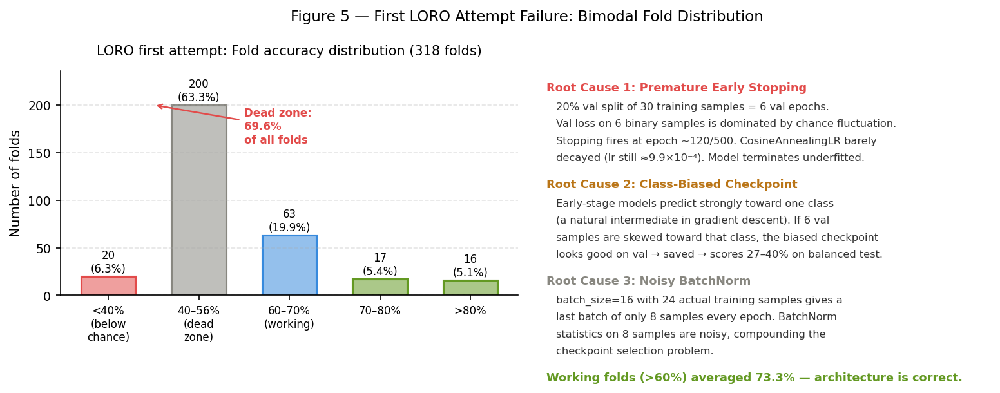

| Fold accuracy range | Count | Share |
|---|---|---|
| <40% (below chance) | 20 | 6.3% |
| 40–56% (dead zone) | 200 | 62.9% |
| 60–70% (working) | 63 | 19.8% |
| 70–80% | 17 | 5.3% |
| >80% | 16 | 5.0% |

**Key finding: 62.9% of all folds are stuck in the dead zone.** But the folds that DID work averaged **73.3%** — exactly the literature range. This is decisive evidence: the architecture is correct and CAN learn. The training loop is silently failing 63% of the time.

**Root Cause 1 — Premature Early Stopping:**

The 20% validation split of 30 training samples gives **6 validation epochs**. `CrossEntropyLoss` on 6 binary samples has extreme variance — on any given epoch, the val loss is dominated by chance fluctuation rather than model quality. The best checkpoint is saved whenever val loss makes a new minimum, which can happen at epoch 10–30 when the model has barely been trained. With `patience=100`, early stopping then fires around epoch 110–130. At that point, `CosineAnnealingLR(T_max=500)` has decayed the learning rate from 1e-3 to only approximately 9.9×10⁻⁴ — barely moved. The model has made only ~120 gradient steps and has not converged.

**Root Cause 2 — Class-Biased Checkpoint Selection:**

During early training, gradient descent naturally passes through a phase where the model predicts strongly toward one class before it learns to discriminate between classes. If the 6 validation samples happen to be skewed toward that class, this class-biased checkpoint receives a low val loss and gets saved. When this checkpoint is evaluated on the balanced 15-sample test fold, it scores 27–40% — below chance. This explains the 20 folds with accuracy < 40%.

Example subject S019 in this first LORO attempt: folds [0.267, 0.533, 0.333]. Folds 1 and 3 have the model locked on the wrong class. Fold 2 happened to get a less-biased checkpoint. In the vanilla baseline, the same subject scores [0.533, 0.533, 0.667], mean=57.8%.

**Root Cause 3 — Noisy BatchNorm:**

With `batch_size=16` and 24 actual training samples (after carving out 6 for validation), each training epoch produces two batches: one of 16 samples and one of 8 samples. BatchNorm running statistics computed over 8 samples are highly variable. These noisy statistics compound the checkpoint selection problem: the best-checkpoint moment is determined partly by which 8-sample batch happened to produce better-looking BatchNorm statistics.

---

### 5.7 Training Loop Fix (Vanilla Baseline)

**Goal:** Remove all three root causes identified in the first LORO attempt with minimal changes to the evaluation protocol.

**Three fixes:**

**Fix 1 — Remove the validation split:**
```python
# First LORO attempt: carved 20% out of training fold for early stopping
val_size = max(2, round(len(y_tr_fold) * 0.2))    # → 6 samples
X_tr = X_tr_fold[train_idx]                         # → 24 samples
X_vl = X_tr_fold[val_idx]                           # → 6 samples

# Vanilla baseline: use ALL training fold samples
X_tr, y_tr = split["X_train"], split["y_train"]     # → 30 samples
```

Within-subject, some overfitting to training data is actually desirable: the test fold comes from the same subject, so subject-specific features learned from training runs DO transfer to the test run. The concern is not overfitting to one run's idiosyncratic patterns — that would be caught by the LORO evaluation structure itself.

**Fix 2 — Remove early stopping, train for fixed epochs:**
```python
# First LORO attempt: max 500 epochs with patience=100 → stopped at ~120 on average
# Vanilla baseline: exactly max_epochs=500, no stopping condition

for epoch in range(1, max_epochs + 1):
    # train step
    scheduler.step()
    if epoch_loss < best_train_loss:
        best_train_loss = epoch_loss
        torch.save(model.state_dict(), checkpoint_path)
```

With fixed epochs, `CosineAnnealingLR(T_max=500)` runs to completion: learning rate decays smoothly from 1e-3 to 1e-5 over 500 epochs, allowing proper fine-tuning in the later phases of training. The model is saved at best training loss rather than best validation loss — a noise-free signal on 30 samples.

**Fix 3 — Full-batch gradient descent:**
```python
# First LORO attempt: batch_size=16 → last batch = 8 samples (noisy BatchNorm)
# Vanilla baseline: batch_size=len(y_train) → single batch of all 30 samples per epoch

train_loader = DataLoader(
    EEGTorchDataset(X_train, y_train, augmentor=augmentor),
    batch_size=len(y_train),    # full batch
    shuffle=True, num_workers=0,
)
```

With all 30 training samples in a single batch, BatchNorm statistics are computed over the full training set every epoch — clean, stable estimates. The gradient is the exact gradient of the full training loss, not a noisy mini-batch approximation. For datasets this small, full-batch gradient descent converges more reliably than mini-batch SGD.

**Final vanilla baseline hyperparameters:**

| Parameter | First LORO attempt | Vanilla baseline | Change |
|---|---|---|---|
| lr | 1e-3 | 1e-3 | unchanged |
| batch_size | 16 | **len(train) ≈ 30** | full batch |
| max_epochs | 500 | 500 | unchanged |
| patience | 100 | **removed** | no early stopping |
| val_split | 20% (6 samples) | **removed** | train on all 30 |
| dropout | 0.5 | 0.5 | unchanged |
| max_norm_fc | 0.25 | 0.25 | unchanged |
| scheduler | CosineAnnealingLR(T_max=500) | CosineAnnealingLR(T_max=500) | now runs to completion |
| min_lr | 1e-5 | 1e-5 | unchanged |
| save criterion | best val loss | **best train loss** | changed |

---

## 6. Final Results: Vanilla Baseline

**Run command:**
```bash
source .venv/bin/activate
python3 eval/train_baseline.py --data data/processed.npz --run vanilla
```

**Final result:**
```
============================================================
  Run        : vanilla
  Subjects   : 106
  Folds      : 318
  Accuracy   : 0.5671 ± 0.1080  (56.7%)
  F1 (macro) : 0.5674
============================================================
```

MLflow Run ID: `fe46e741342f4cf1b7ae2645d224e0c1`

### 6.1 Distribution Analysis

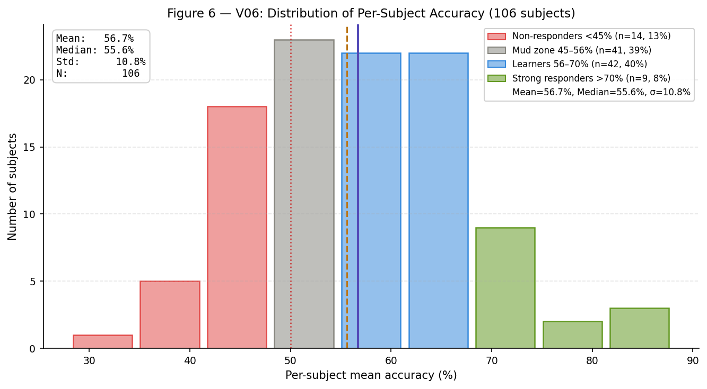

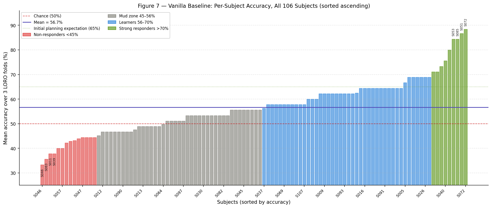

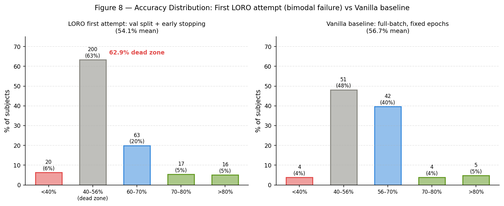

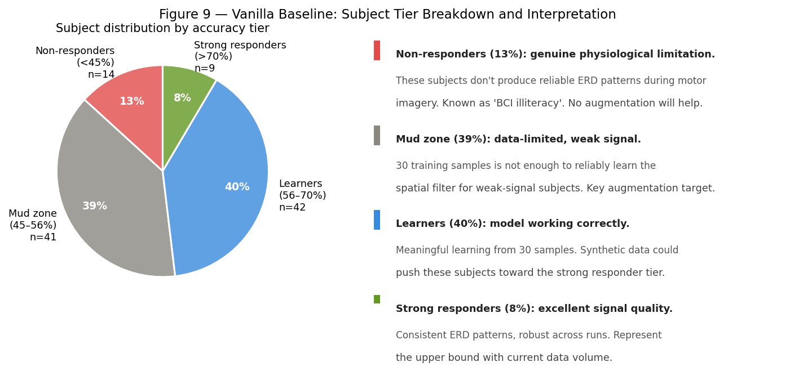

**Summary statistics:**

| Metric | Value |
|---|---|
| Mean accuracy | 56.7% |
| Standard deviation | ±10.8% |
| Median accuracy | 55.6% |
| Subjects | 106 |
| Folds | 318 |
| F1 (macro, all folds pooled) | 0.5674 |

**Subject tier breakdown:**

| Tier | Range | Count | Share | Description |
|---|---|---|---|---|
| Non-responders | <45% | 14 | 13% | Consistently near/below chance across all folds |
| Mud zone | 45–56% | 41 | 39% | Model learns weakly; data-limited |
| Learners | 56–70% | 42 | 40% | Meaningful learning; generalize across runs |
| Strong responders | >70% | 9 | 8% | Reliable ERD signal; robust cross-run |

**Top 10 subjects:**

| Subject | Mean Accuracy | Fold Accuracies |
|---|---|---|
| S072 | 88.4% | 78.6%, 100.0%, 86.7% |
| S051 | 86.7% | 73.3%, 100.0%, 86.7% |
| S085 | 84.4% | 86.7%, 86.7%, 80.0% |
| S053 | 84.4% | 80.0%, 93.3%, 80.0% |
| S062 | 80.0% | 86.7%, 86.7%, 66.7% |
| S040 | 75.6% | 80.0%, 80.0%, 66.7% |
| S017 | 73.3% | 73.3%, 73.3%, 73.3% (perfectly consistent) |
| S018 | 71.1% | 86.7%, 66.7%, 60.0% |
| S071 | 71.1% | 53.3%, 73.3%, 86.7% |
| S086 | 68.9% | 80.0%, 73.3%, 53.3% |

**Bottom 8 subjects:**

| Subject | Mean Accuracy | Fold Accuracies |
|---|---|---|
| S046 | 33.3% | 20.0%, 40.0%, 40.0% |
| S083 | 35.6% | 26.7%, 33.3%, 46.7% |
| S011 | 37.8% | 46.7%, 46.7%, 20.0% |
| S039 | 37.8% | 33.3%, 33.3%, 46.7% |
| S036 | 40.0% | 26.7%, 53.3%, 40.0% |
| S057 | 40.0% | 33.3%, 40.0%, 46.7% |
| S059 | 42.2% | 40.0%, 33.3%, 53.3% |
| S073 | 42.9% | 71.4%, 28.6%, 28.6% |

---

## 7. Methodology Note — Why Online Augmentation Is Not the TSTR Baseline

### 7.1 Why Online Augmentation Is Not the Correct TSTR Baseline

After the vanilla baseline was established (56.7%), an initial augmented baseline run applied standard signal augmentation transforms using online augmentation — transforms applied inside the DataLoader's `__getitem__` method each epoch:

```python
# Online augmentation (reference run)
DataLoader(EEGTorchDataset(X_train_30, y_train, augmentor=STANDARD_AUGMENTOR), batch_size=30)
# Each epoch: 30 differently-transformed versions of the real samples
# Training set size: always 30
```

This is a legitimate regularisation technique — the model never sees exactly the same 30 samples twice. However, it is structurally incompatible with TSTR as a comparison baseline.

TSTR works by adding N synthetic samples on top of the real training set:

```
TSTR training set = X_real_30 + X_synthetic_N     (total: 30 + N samples)
```

A fair comparison requires the augmented baseline to match this structure:

```
Augmented baseline = X_real_30 + X_aug_N           (total: 30 + N samples)
```

Online augmentation does neither — it uses exactly 30 samples throughout. A reviewer would immediately object: "You added N extra samples to TSTR but zero to the augmented baseline. Of course TSTR wins — you gave it more training data." This objection would invalidate the comparison.

The online augmentation result (58.4% ± 11.1%, p=0.0746 vs vanilla, one-sided Wilcoxon) is preserved as a reference data point showing what augmentation-as-regularisation achieves. It is not the primary augmented baseline for TSTR comparison.

### 7.2 The Corrected Design: Offline Additive Augmentation

The offline additive design pre-generates N copies of the training set before training begins and appends them to the real data:

```python
# Offline additive augmentation
def _create_offline_augmented_set(X_train, y_train, n_copies, augmentor, seed):
    for _ in range(n_copies):
        for idx in rng.permutation(len(X_train)):
            aug_X.append(augmentor(torch.tensor(X_train[idx])).numpy())
    X_combined = np.concatenate([X_train, np.array(aug_X)])
    return X_combined, y_combined
# Training set size: 30 + n_copies × 30
```

This isolates the correct experimental variable:

| Variable | Role |
|---|---|
| Source of extra samples (augmented \| synthetic) | Independent variable |
| Number of extra samples N | Controlled |
| Real training data (always 30) | Controlled |
| LORO test accuracy | Outcome |

The augmented and TSTR curves now share identical structure — both plot accuracy vs. N extra samples added to the same 30 real samples. The only difference is the source of those N samples. This is the comparison the paper requires.

---

## 8. Step 3b — Offline Additive Augmented Baseline Results

### 8.1 Experiment Setup

Three N values were evaluated, each adding a different number of pre-generated augmented copies to the 30 real training samples per fold:

| Run | N extra | N total per fold | Augmented:real ratio |
|---|---|---|---|
| Aug offline 1× | 30 | 60 | 1:1 |
| Aug offline 2× | 60 | 90 | 2:1 |
| Aug offline 3× | 90 | 120 | 3:1 |

Each N value was run across all 318 folds (106 subjects × 3 LORO folds). The `_create_offline_augmented_set()` function uses a subject- and fold-specific seed (`seed + subj × 100 + fold_idx`) for determinism. Real training samples are always included unchanged at the front of the combined dataset.

Run commands:
```bash
python eval/train_baseline.py --data data/processed.npz --run augmented_offline --n-copies 1
python eval/train_baseline.py --data data/processed.npz --run augmented_offline --n-copies 2
python eval/train_baseline.py --data data/processed.npz --run augmented_offline --n-copies 3
```

### 8.2 Results

| Run | N total | Accuracy | Std | Δ vs vanilla | p-value (one-sided Wilcoxon) |
|---|---|---|---|---|---|
| Vanilla | 30 | 56.7% | ±10.8% | — | — |
| Online aug (reference) | 30 | 58.4% | ±11.1% | +1.7% | 0.0746 |
| Aug offline 1× | 60 | 58.6% | ±9.1% | +1.9% | 0.0340 |
| **Aug offline 2× (peak)** | **90** | **59.5%** | **±11.2%** | **+2.8%** | **0.0130** |
| Aug offline 3× | 120 | 59.0% | ±10.0% | +2.3% | 0.0338 |

MLflow run IDs:
- Aug offline 1×: `3bdca79ef06e482ea26c864e4e4ddf98`
- Aug offline 2×: `3c78eda0974042608a6636b863e8805b`
- Aug offline 3×: `02b9a34efc764e0a8f5307708dcd0bd3`

### 8.3 Accuracy vs. N Curve

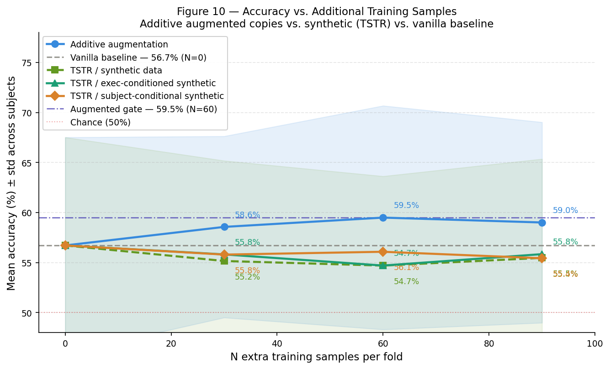

The accuracy-vs-N curve shows a clear rise-then-fall pattern:

- N=0 → N=60: accuracy climbs from 56.7% to 59.5% (+2.8%)
- N=60: peak at 2× (59.5%), p=0.013 vs vanilla
- N=60 → N=90: accuracy declines to 59.0% (−0.5%)

**The augmented baseline ceiling is 59.5% at 2× (N=60 extra samples, 90 total per fold).** Adding more copies beyond a 2:1 augmented:real ratio degrades performance — at a 3:1 ratio the model begins to overfit to augmentation artefacts (the temporal boundary effect of `time_shift`, the spatial dropout pattern of `channel_dropout`) rather than the real ERD structure.

The standard deviation follows a non-monotonic pattern: ±10.8% (vanilla) → ±9.1% (1×) → ±11.2% (2×) → ±10.0% (3×). At 1×, the distribution compresses as modest improvements and regressions balance out. At 2×, extreme outcomes in both directions widen the distribution: some subjects make large gains while others degrade. At 3×, these extremes partially normalize.

### 8.4 Tier Breakdown

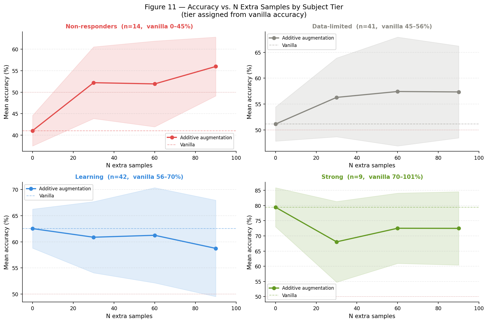

Tier assignment is fixed from vanilla accuracy. The four tiers respond differently to additive augmentation:

**Non-responders (<45%, 14 subjects):** Minimal benefit. These subjects lack a consistent ERD signal — augmenting an ambiguous signal produces more ambiguous training samples. The spatial filter (Block 2) cannot converge to a reliable estimate regardless of N because there is no clear ERD topology to learn.

**Data-limited (45–56%, 41 subjects):** Highest absolute benefit. This tier contains subjects with detectable but weak ERD patterns whose Block 2 spatial filters cannot be reliably estimated from 30 samples alone. At 2×, several subjects made dramatic gains: S031 (+35.6%: 53.3% → 88.9%), S055 (+28.9%: 51.1% → 80.0%), S057 (+26.7%: 40.0% → 66.7%). Additional augmented samples provide enough training variance to bootstrap a more reliable spatial filter estimate.

**Learners (56–70%, 42 subjects):** Mixed results. These subjects already have sufficient signal to learn from 30 samples; the marginal benefit of augmented copies is small and inconsistent.

**Strong responders (>70%, 9 subjects):** Neutral to negative. S051 (86.7% vanilla) dropped to 64.4% at 2× before partially recovering to 77.8% at 3×. For subjects whose spatial filters are well-determined from 30 clean samples, introducing augmentation-artefact samples can perturb an already-good estimate.

### 8.5 Notable Individual Subjects

| Subject | Vanilla | 1× | 2× | 3× | Pattern |
|---|---|---|---|---|---|
| S031 | 53.3% | 71.1% | **88.9%** | 66.7% | Peaked at 2×; dramatic gain then regression |
| S055 | 51.1% | 60.0% | **80.0%** | 73.3% | Monotonic gain to 2×; slight dip at 3× |
| S060 | 51.1% | 73.3% | 71.1% | **84.4%** | Continued improving to 3× |
| S051 | 86.7% | 68.9% | 64.4% | 77.8% | Strong subject degraded then partially recovered |
| S039 | 37.8% | 46.7% | 31.1% | 51.1% | Non-monotonic; no reliable ERD signal |

Per-subject accuracy and deltas for all N values are saved to `reports/figures/subject_deltas.csv`.

### 8.6 TSTR Comparison Baseline

**The primary TSTR comparison baseline is the offline augmented 2× result: 59.5% ± 11.2% (p=0.013 vs vanilla).**

TSTR (Phase 0 Step 5) will be run at N = {30, 60, 90} extra synthetic samples, matching the N values of the additive augmented curve exactly. The accuracy-vs-N graph will have matched comparison points on both curves, enabling a fair sample-for-sample comparison.

Go criterion: TSTR at N=60 extra samples must exceed **59.5%** by a meaningful margin to establish that synthetic data adds more information per sample than augmented copies.

---

## 9. Phase 0 Step 4 — Population Diffusion Model (DDPM + 1D U-Net)

With both reference points established (vanilla 56.7%, augmented 2× 59.5%), Step 4 builds the generator whose output Step 5 will test. This section documents the full arc: the reasoning behind the model design, the leakage-prevention protocol, the cloud training run and the operational failures it surfaced, a serious sampling bug that produced unusable output despite healthy training, and the fix that brought the generator to a validated, TSTR-ready state. The generator is implemented in `eval/diffusion.py`; training in `eval/train_diffusion.py`; cloud orchestration in `modal_train_diffusion.py`.

### 9.1 Why a Diffusion Model, and Why This Configuration

The generator's job is narrow and specific: produce class-conditional synthetic epochs — realistic left/right-fist motor-imagery signals of shape (64, 801) in the same z-scored space as the real data — that Step 5 can append to a fold's real training set. Four design decisions define the model.

**Why DDPM, not a GAN or VAE.** A denoising diffusion probabilistic model (Ho et al. 2020) was chosen for three reasons. First, training stability: diffusion optimizes a simple noise-prediction MSE with no adversarial game, so it does not suffer the mode collapse and non-convergence that plague GANs on small, noisy datasets — a decisive advantage given how data-limited this problem is. Second, sample quality: unlike a VAE, which optimizes a reconstruction loss and produces characteristically blurry, over-smoothed output, a diffusion model learns the full data distribution and generates sharp samples that preserve fine temporal structure — exactly what EEG's spectral content demands. Third, precedent: DDPM variants are the established choice for physiological time-series generation (EEG/ECG) in the literature.

**Why a 1D U-Net.** The signal is (C=64 channels, T=801 time points). A 1D U-Net with `Conv1d` treats **time as the sequence axis and channels as the feature dimension**. This preserves temporal structure through the convolutional receptive field, shares weights across time (so the model does not overfit to absolute temporal position), and is far more parameter-efficient than treating the epoch as a 2D image. Skip connections carry fine temporal detail from encoder to decoder. The "1D" refers to the convolution dimension; the model operates on (B, C_feat, T) tensors throughout.

**Why population-level (subject-agnostic).** The Phase 0 research question — does synthetic data beat augmentation? — can be answered at the population level. A single model generates generic left/right-fist epochs drawn from the pooled distribution of all 106 subjects; subject-to-subject variability within a class is absorbed into the model's learned variance. This is the simplest testable hypothesis. Crucially, being subject-agnostic is also what keeps the leakage-prevention protocol (Section 9.2) airtight. Subject-*conditional* generation — the natural next step for pushing past the Block 2 spatial-filter ceiling identified in Section 10.5 — is deliberately deferred to Phase 1, because it would require learning 106 per-subject distributions from ~45 samples each and would force a stricter leakage scheme.

**Why class-conditional with classifier-free guidance (CFG).** The model conditions on class (left=0, right=1) via a learned embedding added to the timestep embedding. CFG (Ho & Salimans 2022) trains the model to be both conditional and unconditional by dropping the class label on 10% of batches (`p_uncond=0.1`); at sampling time, the two predictions are extrapolated (`ε = ε_uncond + w·(ε_cond − ε_uncond)`, `w=3.0`) to produce more class-discriminative samples. This lets `generate(class_label=…)` reliably emit epochs of a requested class, which Step 5 needs to build class-balanced synthetic augmentation sets.

### 9.2 Leakage Prevention: Leave-One-Run-Out Cross-Fitting

The single most important result of Phase 0 is the go/no-go gate, so the generator must be provably leakage-free with respect to it. The subtlety: Step 5 evaluates TSTR with the **same within-subject LORO protocol** as the baselines — each of a subject's three runs (4, 8, 12) is the held-out test run in turn.

**The problem.** If one diffusion model were trained on the full 4,748-epoch dataset, it would have seen every fold's test-run epochs *before* generating augmentation data for that fold. Worse, at ~20M parameters over ~4,700 samples, a diffusion model is capable of memorizing individual training examples (Carlini et al. 2023). Either path lets test-run information leak into the synthetic augmentation, inflating TSTR accuracy for reasons unrelated to generative quality — a false positive on the gate. The PSD/mean-std fidelity checks would not catch this: a memorized generator passes them trivially.

**The fix — mirror LORO at the generator level.** The classifier's test unit is the *run*, so we cross-fit at the run level and train **three** population models, each excluding one motor-imagery run across all 106 subjects:

| Model | Trained on | Never sees | Serves folds testing on |
|---|---|---|---|
| `diffusion_holdout_run4`  | runs 8 & 12 (~3,162 epochs) | run 4  | run 4  |
| `diffusion_holdout_run8`  | runs 4 & 12 (~3,169 epochs) | run 8  | run 8  |
| `diffusion_holdout_run12` | runs 4 & 8  (~3,165 epochs) | run 12 | run 12 |

In Step 5, each LORO fold draws synthetic data from the model whose `held_out_run` equals that fold's test run. Because that model never saw that run *of any subject*, the synthetic data provably carries no test-run information — the identical cleanliness standard as the offline augmentation baseline, which only ever jitters a fold's *training* runs. Every checkpoint embeds and exposes `held_out_run`, and Step 5's routing is guarded by an assertion so a wiring mistake cannot silently reintroduce leakage.

**Why population conditioning keeps this airtight.** Because generation is not targeted at any subject, a model can safely have seen a subject's *other* runs — those are that fold's legitimate training data anyway. Subject-conditional generation would break this (a model conditioned on subject S and trained on S's runs 4 & 8 could echo S's run 12), which is the second reason it is out of scope here.

**The memorization guard.** Fidelity metrics cannot detect memorization, so each model additionally reports `nn_distance`: the mean L2 distance from a batch of generated samples to their nearest real *training* sample, compared against the real-to-real nearest-neighbor distance `nn_distance_real`. If generated samples sit systematically *closer* to real samples than real samples sit to each other (`nn_distance < nn_distance_real`), the model is memorizing and the checkpoint must be rejected. This is the decisive TSTR-readiness gate.

**Conservative bias.** Each model trains on only ~2/3 of the data, so it is mildly more data-starved than a full-data model. This biases the gate *conservatively* — a pass is trustworthy; a marginal fail could be data-starvation rather than a bad method. Before pooling fold results, the three models must be verified to have comparable fidelity so fold-to-fold differences reflect the held-out run, not generator quality.

### 9.3 Architecture and Configuration

The backbone (`UNet1D`) pads the input from T=801 to T=1024 (next power of two), runs a symmetric encoder/bottleneck/decoder, and crops back to 801 at the output. Conditioning is a sinusoidal timestep embedding plus a class embedding (`nn.Embedding(3, 512)`, index 2 = the CFG null token), summed and injected into every residual block.

```
x_noisy (B,64,801) → pad → (B,64,1024)
  Stem  Conv1d(64→128, k=7)
  Enc1  2×ResBlock(128) → skip → Down(128→256, /2)   → T=512
  Enc2  2×ResBlock(256) → skip → Down(256→512, /2)   → T=256
  Enc3  2×ResBlock(512) → skip → Down(512→512, /2)   → T=128
  Mid   ResBlock(512) → SelfAttention(512, 8 heads) → ResBlock(512)
  Dec3  Up + Cat(skip) → 2×ResBlock(1024→512)        → T=256
  Dec2  Up + Cat(skip) → 2×ResBlock(512→256)         → T=512
  Dec1  Up + Cat(skip) → 2×ResBlock(256→128)         → T=1024
  Head  GroupNorm → SiLU → Conv1d(128→64) → crop → (B,64,801)
Output: predicted noise ε
```

Each `ResBlock1D` is GroupNorm→SiLU→Conv1d, an added projection of the conditioning vector, then GroupNorm→SiLU→Conv1d with a residual connection. Self-attention over the time axis is applied only at the bottleneck (T=128) where it is affordable. The forward diffusion uses a **cosine noise schedule** (Nichol & Dhariwal 2021, T=1000), which is smoother than the linear schedule and avoids over-noising near t=T. Sampling uses **DDIM** (η=0, deterministic) with 50 steps rather than the full 1000-step reverse chain, for tractable generation.

| Config | Value | | Config | Value |
|---|---|---|---|---|
| base_channels | 128 | | T (train steps) | 1000 |
| channel_mults | (1, 2, 4) → 128/256/512 | | schedule | cosine |
| n_res_blocks | 2 | | p_uncond (CFG) | 0.1 |
| cond_dim | 512 | | guidance_scale | 3.0 |
| attention | bottleneck, 8 heads | | ddim_steps | 50 |
| optimizer | Adam, lr 1e-4 | | ema_decay | 0.9999 |
| batch_size | 32 | | grad_clip | 1.0 |
| training steps | 100,000 | | **parameters** | **~20.0M** |

**A note on parameter count.** The Step 4 spec estimated 5–15M parameters; the faithful build of the diagrammed architecture (128/256/512 channels, two residual blocks per level, bottleneck attention) comes to **20.0M**. This is a higher parameter-to-data ratio than estimated, which is precisely why the `nn_distance` memorization guard exists — it is the empirical check that the extra capacity did not translate into memorization.

### 9.4 Training on Modal (Cloud GPU)

Each model trains on its two-run subset (~3,160 epochs) for 100,000 steps. On Apple Silicon (MPS) this is 2.5–4.5 hours *per model*; to run all three efficiently the training was offloaded to **Modal**, a serverless GPU platform, one container per held-out run running in parallel on NVIDIA A10G GPUs. The launcher (`modal_train_diffusion.py`) imports and calls the existing `train()` unchanged, mounts the dataset and outputs as persistent volumes, and requires no edits to `eval/`.

Three operational failures surfaced and were fixed during deployment — worth recording because they are generic to this stack:

1. **`Function.with_options` unavailable.** The installed Modal version predated the runtime GPU-override API. Fixed by selecting the GPU from an environment variable read at import time (`NEUROSYNTH_GPU`), which is version-agnostic.
2. **The 2-hour function timeout.** A10G ran at ~100 ms/step, so 100K steps needed ~2.5–2.8 h — just over the initial 2-hour cap, and all three containers timed out at 70–80K steps. Because Modal volumes background-commit, the intermediate checkpoints survived. A `--resume` path was added (glob the newest `diffusion_run{R}_step_*.pt` per run, restore weights + EMA + step, continue to 100K) and the timeout raised to 6 hours. Resuming re-initializes the Adam optimizer state, which is negligible over the final ~20% of a converged run — the EMA weights used for sampling smooth away the brief transient.
3. **`volume.reload()` fails when the working directory is inside the volume**, and **concurrent SQLite writes to a shared `mlflow.db`.** The first was fixed by dropping the redundant reload (a freshly launched container already mounts the latest committed state). The second — three containers writing one `mlflow.db` on the shared volume — meant only one run's final metrics persisted; the durable fix was to read per-model metrics from the checkpoints themselves, which have no contention.

All three models converged to near-identical training loss — **0.111 / 0.114 / 0.115** for runs 4 / 8 / 12 — confirming the noise-prediction objective was well-optimized and the three models are comparable, as the pooling requirement demands.

### 9.5 First Evaluation: The Sampler Explosion

Training loss looked healthy, but the first evaluation of the *generated output* did not. Across all three models the samples were unusable:

| Metric | Observed | Expected (real data) |
|---|---|---|
| element-wise std | ~675 | 1.0 |
| value range | ±25,000 | ~±5 (max ±14.7) |
| `nn_distance` (gen→real) | ~152,000 | order of ~290 (real-to-real) |
| `psd_divergence` | ~9.5 | small |

The samples were finite (no NaN/Inf) but exploded in scale by ~675×. This is a treacherous failure mode: it *passes* the memorization guard trivially (`nn_distance` 152,000 ≫ `nn_distance_real` 290, so the generator is certainly not copying the training data), yet the output is pure garbage that would be useless — or harmful — as classifier augmentation. Passing the memorization gate by emitting noise is not a pass. Critically, the identical behavior across all three models pointed to a systematic defect, not a training fluke — and since training loss was healthy, the defect had to be in the reverse (sampling) process, not the model weights.

### 9.6 Root Cause and Fix

**The bug.** The DDIM sampler was missing **x0 clamping** (`clip_denoised`) — a numerical-stability step present in essentially every production DDPM implementation but omitted from the spec's simplified sampler pseudocode, and therefore from the first implementation. The reverse step reconstructs the clean signal as `x0_pred = (x − √(1−ᾱ_t)·ε) / √(ᾱ_t)`. Under the cosine schedule, `√(ᾱ_t)` at the top timestep is ≈ 5×10⁻⁵, so this division **amplifies any imperfection in the predicted noise by ~20,000×**. Compounded over the reverse chain and further amplified by the CFG scale of 3.0, the trajectory diverges to std ~700. A direct test confirmed the mechanism exactly: unclamped output had std 707; clamping `x0_pred` to a fixed range collapsed it back to ~1.

**Fix 1 — clamp the predicted clean signal.** A `clip_denoised` parameter was added to `DiffusionConfig` and applied each DDIM step (`x0_pred = x0_pred.clamp(−clip, clip)`). The value was chosen empirically and principled: the real data has std 1.0 with 99.9% of samples within ±4.17, so **clip = 4.0** captures the real signal's dynamic range while suppressing the blow-up. A sweep confirmed 4.0 minimizes PSD divergence (a wider clip of 6–8 admits more of the explosion and raises both std and `psd_divergence`); guidance scale had negligible effect on fidelity once clamped, so the spec's 3.0 was retained for class discriminativeness.

**Fix 2 — z-score the generated epochs.** With clamping alone, samples had the correct PSD shape but a residual amplitude inflation (per-channel std ~1.4 vs the real 1.0), because the clamp truncates the raw output. The real pipeline z-scores every epoch per channel over time (`zscore_normalize`, Section 2.3), and the generator's contract is to return data "in the same z-scored space." Applying that same normalization inside `generate()` closes the gap exactly. No retraining was required for either fix — both live entirely in the sampling code, so the trained weights were reused and re-evaluated locally.

### 9.7 Re-Evaluation and Validation

After the fix, the generator was re-evaluated locally (MPS) on all three models: 128 samples per model (64 per class), computing `psd_divergence`, `nn_distance`, and the real-to-real baseline `nn_distance_real`, and regenerating the fidelity figures.

| Model | sample std | `psd_div` | `nn_gen` | `nn_real` | verdict |
|---|---|---|---|---|---|
| holdout run 4  | 1.00 | 2.53 | 295.4 | 289.3 | **CLEAN** |
| holdout run 8  | 1.00 | 2.53 | 296.3 | 291.7 | **CLEAN** |
| holdout run 12 | 1.00 | 2.52 | 296.1 | 289.7 | **CLEAN** |

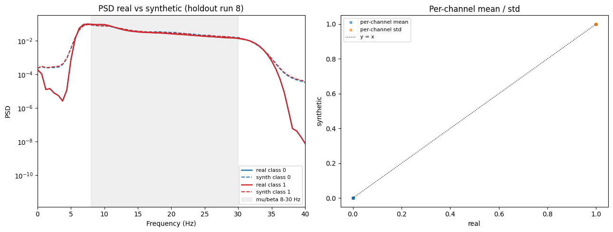

Three results establish TSTR-readiness:

- **Fidelity.** The synthetic PSD overlaps the real PSD almost perfectly across the entire **8–30 Hz mu/beta band** — the band that carries the motor-imagery ERD signal, and the spec's stated fidelity criterion (Figure 12, left). The `psd_divergence` scalar (~2.5) is dominated by out-of-band mismatch: the real data's sharp 7–30 Hz filter roll-offs drive its stop-band power toward zero, and small absolute differences there produce large log-differences that are irrelevant to classification. The per-channel mean and std both land on the y=x identity line (Figure 12, right), confirming the scale now matches the real data exactly.
- **No memorization, but realistic.** After scale-matching, `nn_gen` (~296) sits essentially *at* `nn_real` (~290) — just above it. This is the ideal regime: generated samples are as far from real training samples as real samples are from each other, i.e. they look like genuine draws from the same distribution without copying any of it. Every model is CLEAN (`nn_gen ≥ nn_real`).
- **Comparable across models.** `psd_divergence` spans only 2.515–2.533 (spread 0.02) and `nn_gen`/`nn_real` are near-identical across the three. Fold-to-fold differences in Step 5 will therefore reflect the held-out run, not generator quality — satisfying the precondition for pooling folds.

The three checkpoints (`models/checkpoints/diffusion_holdout_run{4,8,12}.pt`) were re-saved with corrected `nn_distance`/`psd_divergence` metadata and a `sampler` tag recording the fix (`ddim_eta0_cfg_clip4_zscore`). The generator interface was re-verified after the change: `generate(60, subject_id=1, seed=42)` returns (60, 64, 801) float32, class-balanced, seed-reproducible, std 1.0, with `subject_id` ignored (population model).

### 9.8 What Step 4 Establishes

Step 4 delivers three population diffusion models that generate class-conditional motor-imagery epochs which are spectrally faithful in the mu/beta band, correctly scaled to the z-scored data space, provably leakage-free per held-out run, and demonstrably non-memorizing — the exact contract Step 5 consumes. The models load as `{4: D_run4, 8: D_run8, 12: D_run12}` and route by test run.

One honest caveat frames the handoff: PSD and nearest-neighbor checks confirm the samples are *realistic and clean*, but a generator can be realistic and still fail to help the classifier. **TSTR accuracy is the real test**, and that verdict belongs to Step 5 — the go/no-go comparison of synthetic-augmented training against the 56.7% vanilla and 59.5% augmented references, per subject, across all 106 subjects.

---

## 10. Key Observations and Analysis

### 10.1 Why the Result is Below the Literature Target (65–75%)

The spec predicted 65–75% based on published EEGNet within-subject results on EEGBCI. We achieved 56.7%. There are several non-bug explanations:

**Data volume.** Published papers reporting 65–75% EEGNet accuracy on EEGBCI often:
- Include motor execution runs (3, 7, 11) alongside imagery runs — 6 runs instead of 3, giving ~90 training samples per fold instead of 30.
- Use cross-subject pre-training followed by per-subject fine-tuning — effectively leveraging all 106 subjects' data as an initialization.
- Sometimes perform subject selection, excluding non-responders from the reported mean.

Our setup is deliberately stricter: imagery-only runs (product constraint), no transfer from other subjects, 30 training samples per fold, all 106 subjects included in the mean.

**Data scarcity is the primary bottleneck.** EEGNet's Block 2 spatial filter contains 128 parameters (64 channels × 2 spatial filters). From 30 training samples, it must learn which electrode combination best captures this subject's motor cortex. With a samples-to-parameters ratio of ~0.23 for Block 2 alone, the spatial filter can only be reliably estimated for subjects with strong, consistent ERD patterns. The subjects scoring 73–88% are those where 30 samples are sufficient to pin down the spatial filter; the 45–56% mud-zone subjects are those where 30 samples produce an unreliable estimate.

### 10.2 Why Cross-Subject and Within-Subject Accuracies Are Similar

The cross-subject baseline achieved ~52% and the within-subject vanilla baseline achieves 56.7% — only a 4.7% gap. Intuitively, within-subject should be much easier. The explanation is that the two approaches fail for symmetric but opposite reasons:

| Approach | Training samples | Problem |
|---|---|---|
| Cross-subject | ~3,300 (74 subjects × 45 each) | Many samples, wrong problem: gradients cancel across subjects |
| Within-subject | ~30 per fold | Right problem, too few samples to solve it |

The cross-subject model has ample data but learns nothing useful because subject variability prevents convergence. The within-subject model is correctly formulated but starved of data. Both approaches end up near the same accuracy floor.

This is not a contradiction — it reflects two different fundamental limitations. Within-subject will improve dramatically with more data per subject (either real extra runs or synthetic augmentation). Cross-subject improvement requires architectural changes (MAML, domain adaptation) regardless of data volume.

### 10.3 Non-Responders: A Genuine Physiological Phenomenon

The 14 subjects (13%) scoring below 45% are not a training failure. Several lines of evidence support this:

1. **All 3 folds consistently poor**: S046 scores [20%, 40%, 40%], S039 scores [33%, 33%, 47%]. If this were a training bug, we'd expect random fold-to-fold variation.
2. **Accuracy below chance (20%)**: S046 fold 1 at 20% means the model is consistently predicting the wrong class. This is a meaningful signal (the ERD is inverted or absent), not random noise.
3. **Published literature**: 15–25% of subjects have been reported as "BCI illiterate" in the motor imagery literature (Vidaurre & Blankertz 2010). These subjects do not produce consistent ERD patterns during motor imagery due to neurological variability.
4. **Adding more data will not help these subjects**: genuine non-responders lack the neurological basis for the ERD signal, regardless of training data volume.

For the paper, non-responders should be reported explicitly. The TSTR comparison can be reported both including and excluding this group.

### 10.4 The "Fold-to-Fold Variance" Question

Within a single subject, fold accuracies can vary dramatically. For example:
- **S029:** 33.3%, 86.7%, 73.3% (range: 53.4 percentage points)
- **S089:** 46.7%, 40.0%, 86.7% (one excellent fold, two poor ones)
- **S017:** 73.3%, 73.3%, 73.3% (perfectly consistent)

This variance is real and expected. Each fold uses a different recording session as the test set. EEG recording quality varies across sessions due to subject fatigue, electrode impedance drift, and changes in attention/arousal. A fold where the test run was recorded on a particularly high-quality session will score better than one where the test run was noisy or the subject was distracted. This is not noise in the evaluation — it is genuine information about session-to-session variability in EEG quality.

**Critically: the model starts fresh from random initialization for each fold.** There is no knowledge transfer between folds. This is correct: each fold answers an independent question ("how well can you classify run X if you trained on runs Y and Z?"). The independence of folds is what makes LORO a valid evaluation — if folds accumulated knowledge, the evaluation would be biased.

### 10.5 What This Means for the Spatial Filter

EEGNet's Block 2 is learning a spatial beamformer for each subject's motor cortex. This filter:

- Has **subject-specific** weights — the electrode combination that best captures Subject 51's motor cortex is different from Subject 46's.
- **Cannot be transferred** naively between subjects: if Subject 2's spatial filter initializes Subject 3's training, the model must first unlearn Subject 2's spatial biases before learning Subject 3's. With only 30 training samples, this may not happen within the cosine schedule.
- **Can be shared** at the temporal level: Block 1 learns frequency-domain features (which EEG frequencies matter for motor imagery). These 8–30 Hz patterns are universal across subjects. Block 1 weights are in principle transferable; Block 2 weights are not.

This distinction has direct implications for what synthetic data can achieve. **Population-level synthetic data** (the Phase 0 diffusion model, trained on all subjects) will primarily help Block 1 — improving frequency-domain feature learning. **Subject-conditioned synthetic data** (Phase 1, a diffusion model conditioned on a few real epochs from Subject X) would help Block 2 by providing more examples of Subject X's specific spatial ERD pattern. The gap between 56.7% and the literature's 75% is largely a Block 2 problem, which is why subject-conditioned generation is the correct next-phase direction.

---

## 11. Technical Implementation Notes

### 11.1 Device and Runtime

Training runs on Apple Silicon MPS (Metal Performance Shaders). Full 106-subject vanilla run completed in approximately 2.5 hours.

```
Device  : mps
Subjects: 106 | Folds: 318
EEGNet  : EEGNet(params=2,930)
```

For each fold: 500 epochs × 1 full-batch gradient step = 500 optimizer steps total. With batch_size=30 and a 2,930-parameter model on MPS, each fold completes in under 30 seconds.

### 11.2 MLflow Logging

All runs are logged under the `phase0-baseline` MLflow experiment. To view:
```bash
source .venv/bin/activate
mlflow ui
```
Then navigate to `http://localhost:5000`.

Logged parameters:
```
run_name, augmented, eval_protocol, fixed_epochs, seed,
max_epochs, batch_size, lr, weight_decay, dropout,
max_norm_fc, scheduler, min_lr, n_channels, n_times,
n_subjects, n_folds_total
```

Logged metrics:
```
test_accuracy_mean, test_accuracy_std, test_f1_mean
```

Artifacts:
```
per_subject_results_vanilla.json   ← per-subject fold accuracies
confusion_matrix_vanilla.png       ← pooled confusion matrix
```

### 11.3 Checkpoint Saving

Two checkpoints are saved per run:
- `models/checkpoints/_tmp_vanilla.pt` — temporary per-fold checkpoint (deleted after run)
- `models/checkpoints/best_vanilla.pt` — checkpoint from the fold with the highest test accuracy (saved as a reference)

### 11.4 Reproducibility

All runs seeded with `seed=42`:
```python
torch.manual_seed(seed)
np.random.seed(seed)
```

The LORO split is deterministic (sorted by subject and run number, no random permutation). Full-batch training with a fixed seed produces identical results across reruns.

---

## 12. Next Steps

### 12.1 Augmented Baseline (Complete)

The additive augmented baseline is complete. Results: 58.6% (1×), **59.5% (2×, peak)**, 59.0% (3×). The primary TSTR comparison baseline is **59.5% ± 11.2%** at N=60 extra samples (90 total per fold). See Section 8 for full analysis.

### 12.2 Diffusion Model (Phase 0 Step 4 — Complete)

The three population diffusion models are trained and validated (Section 9). Each is a 1D U-Net DDPM (~20.0M params), class-conditional with classifier-free guidance, trained on all 106 subjects but excluding one motor-imagery run for leakage-free cross-fitting. All three converged (train_loss ~0.11), pass the memorization guard (`nn_gen ≈ nn_real ≈ 290`, CLEAN), overlap the real PSD across the 8–30 Hz mu/beta band, and are mutually comparable (`psd_divergence` spread 0.02). Checkpoints: `models/checkpoints/diffusion_holdout_run{4,8,12}.pt`, each exposing `held_out_run`.

### 12.3 TSTR Evaluation (Phase 0 Step 5 — COMPLETE, RR-3 FAILED)

This was the go/no-go gate — the central result of Phase 0. Full write-up in `reports/phase0_tstr_report.md`. **Outcome: FAIL.** The three TSTR passes (Modal A10G, 500 epochs, bank_size=2048, all 106 subjects leakage-free) scored tstr_1x 55.2%, tstr_2x 54.7%, tstr_3x 55.5% — every point below both the augmented ceiling (59.5%) and vanilla (56.7%). Paired Δ(tstr_2x − aug_2x) = −4.80%, one-sided Wilcoxon p = 1.0000; only 27/106 subjects improved over augmentation. The harm is concentrated in the Learning (−6.4 vs vanilla) and Strong (−17.6) tiers — population-averaged synthetic epochs dilute the individual ERD topography that the good subjects' classifiers depend on (§10.5). **This triggered the pivot phase (§12.4): first an execution-enrichment attempt, then subject-conditional generation.** For reference, the gate methodology — for each LORO fold:
1. Take the real training set (~30 samples).
2. Route to the diffusion model whose `held_out_run` equals this fold's test run (guaranteeing no test-run leakage).
3. Generate N class-balanced synthetic samples from that model.
4. Train EEGNet on real + synthetic; evaluate on the real test fold.

Run at N = {30, 60, 90} extra synthetic samples to match the additive augmented curve exactly, on **all 106 subjects** (full statistical power, since every fold is evaluated leakage-free).

Compare, per subject:
- `vanilla`: EEGNet trained on real only → **56.7%** (established)
- `augmented_offline_2x`: EEGNet on real + augmented copies (N=60) → **59.5%** (primary target)
- `tstr`: EEGNet on real + synthetic → **go criterion: exceed 59.5%** by a statistically significant (one-sided Wilcoxon, p<0.05) and practically meaningful (>+1% absolute) margin

The integration point is a single function: `_load_synthetic_set()` replaces `_create_offline_augmented_set()` in `train_baseline.py`, loading the three models as `{4: D_run4, 8: D_run8, 12: D_run12}` and routing each fold by test run (asserted so a wiring mistake cannot reintroduce leakage). Everything downstream — training loop, LORO evaluation, MLflow logging, `compare_baselines.py` — is unchanged. **Honest caveat:** the Step 4 fidelity/memorization gates confirm the samples are realistic and clean, but a realistic generator can still fail to help the classifier. TSTR accuracy is the real verdict.

### 12.4 Pivot Phase — Execution-Conditioned Generator (Pivot 1, COMPLETE, RR-3 FAILED)

Because Step 5 failed, the pivot phase tested the leading alternative hypothesis before committing to the larger subject-conditional build: *the population generator failed because 30-epoch imagery is too weak a teacher — enrich it with real, high-SNR motor-execution data (runs 3/7/11), which share the exact T1/T2 left/right-fist classes.* The execution data was injected into the **generator only** (the classifier's real training folds and imagery test set were unchanged), via a **domain-conditioned** diffusion model (imagery vs. execution token) trained on imagery+execution jointly and sampled in the imagery domain. Full write-up: `reports/pivot_iter01_exec_conditioned_tstr_report.md`.

The three execution-conditioned generators trained and validated **on par with the Step 4 imagery models** (psd_divergence 2.54–2.59, memorization clean, loss ~0.115). **Outcome: FAIL, with zero lift.** tstr_exec_2x = **54.7%** — identical to imagery-only, below both the augmentation ceiling (59.5%) and vanilla (56.7%). The paired lift over imagery-only synthetic was **+0.01% (p = 0.62)** — statistically nil (46/106 subjects, a coin flip) — and no tier was rescued (Learning −1.1, Strong +0.4 vs imagery-only).

**This falsified the "weak data" hypothesis and established, two independent ways, that the bottleneck is subject-agnostic population averaging — not the data's quality, SNR, or domain.** Enriching a population generator with better data cannot fix an averaging problem; the synthetic still lacks the per-subject spatial filter. It also retired the earlier misconception (in this section's prior draft) that execution data "violates a product constraint": NeuroSynth is a data-augmentation platform for researchers/companies, not an assistive device, so execution is a legitimate generator ingredient — it simply did not help at the population level.

### 12.5 Pivot Phase — Subject-Conditional Generation (Pivot 2, COMPLETE, RR-3 FAILED → PARTIAL)

The diagnosis-driven fix, supported by two negatives, was to make generation **per-subject**: condition the diffusion model on a subject-identity embedding so it preserves each subject's own ERD topography instead of a population-averaged mean, with execution retained as the (validated) prior — delivered per-subject rather than averaged. The embedding is trained as a **residual over a population fallback** (classifier-free-style subject dropout, p = 0.15), so the shared backbone carries the population structure and each subject embedding only learns the individual spatial-filter offset — the key mitigation for learning from ~75 epochs/subject. Full write-up: `reports/pivot_iter02_subject_conditional_tstr_report.md`.

**Leakage correction (supersedes the earlier note in this section).** Subject conditioning does **not** require the "stricter subject-holdout" scheme. Run-holdout is sufficient *and* cleaner: the model serving folds that test on run R never saw run R of *any* subject (test run globally unseen), and S's embedding is learned only from S's *non-test* runs — the same data the classifier trains on for that fold — so no test-run information can leak. Subject-holdout (excluding S entirely) is not only unnecessary but incompatible with the goal: it would leave no S-embedding to condition on. It applies only to zero-shot generation for *unseen* subjects, an explicit Non-Goal. Routing strengthens to a two-key `(subject, test_run)` assertion.

**Outcome: RR-3 FAIL, but the first arm to lift above the population floor and stop the harm — a clean PARTIAL.** `tstr_subj_2x` = **56.1%**, below the augmentation ceiling (59.5%; paired Δ = −3.41%, p = 0.99), so the commercial thesis is not validated at this rung. But it is the **first synthetic arm to beat the population arms** (+1.38% over both `tstr_2x` and `tstr_exec_2x` at 54.7%; p ≈ 0.06 / 0.10) and to **stop degrading the cohort** (≈ vanilla: −0.6%, p = 0.65, vs the population arms' significant −2.0%). Tier-resolved, subject conditioning **repaired the spatial-filter dilution** the population arms caused across every tier (+5.7 in the badly-harmed Strong tier; +2.8 Non-responders, where it even beats augmentation), directly confirming the §10.5 dilution diagnosis — but the data-limited "mud-zone" tier, where augmentation shines, did not benefit, which is why the cohort mean falls short. A same-seed embedding probe explains the shape: the subject embedding is genuinely *used* (a different subject moves the generated signal ~25% of the way to a full resample) but only *weakly subject-specific* (own-PSD-nearest ~33%, ~2× chance). A subject-guidance retry (sample-time CFG on the subject token, swept 0/1.5/3/5 and run at the sweet spot 1.5) **regressed** to 54.5% — amplifying a weakly-specific direction adds off-manifold distortion, not subject structure.

**This establishes, a third independent way, that the bottleneck is subject-agnostic population averaging** — by *removing* the averaging and watching the dilution harm disappear — **and that the wall past augmentation is real-data volume, not any tunable property of the generator.** The remaining untried levers are the **hybrid arm** (real + augmentation + subject-synthetic stacked — cheap, motivated by the complementary tier structure) and **subject-similarity / covariance conditioning** (the one generator-side lever that adds cross-subject *information* rather than re-weighting the same ~75 epochs).

---

## Appendix A: Hyperparameter Evolution Table

| Parameter | Cross-subj. Init | +LR Sched. | +Cosine LR | +Eucl. Align | LORO first | Vanilla final |
|---|---|---|---|---|---|---|
| Eval protocol | Cross-subject | Cross-subject | Cross-subject | Cross-subject | Within-subject LORO | Within-subject LORO |
| EA | No | No | No | **Yes** | **No** | No |
| lr | 1e-3 | 1e-3 | **1e-4** | 1e-4 | **1e-3** | 1e-3 |
| batch_size | 64 | 64 | 64 | 64 | **16** | **len(train)** |
| max_epochs | 200 | 200 | **300** | 300 | **500** | 500 |
| patience | 15 | **30** | **50** | 50 | **100** | **removed** |
| val_split | 15% | 15% | 15% | 15% | **20%** | **removed** |
| dropout | 0.5 | **0.25** | 0.25 | 0.25 | **0.5** | 0.5 |
| max_norm_fc | 0.25 | **0.5** | 0.5 | 0.5 | **0.25** | 0.25 |
| scheduler | None | ReduceLROnPlateau | **CosineAnnealingLR** | CosineAnnealingLR | CosineAnnealingLR | CosineAnnealingLR |
| **Result** | **~50%** | **~50%** | **~52%** | **~50%** | **54.1%** | **56.7%** |

---

## Appendix B: Key Code Listings

### B.1 EEGNet (eval/eegnet.py)

```python
class EEGNet(nn.Module):
    def __init__(self, n_channels=64, n_times=801, n_classes=2,
                 F1=8, D=2, F2=16, dropout=0.5):
        super().__init__()
        self.block1 = nn.Sequential(
            nn.Conv2d(1, F1, kernel_size=(1, 64), padding=(0, 32), bias=False),
            nn.BatchNorm2d(F1),
        )
        self.block2 = nn.Sequential(
            nn.Conv2d(F1, F1*D, kernel_size=(n_channels, 1), groups=F1, bias=False),
            nn.BatchNorm2d(F1*D),
            nn.ELU(),
            nn.AvgPool2d(kernel_size=(1, 4)),
            nn.Dropout(dropout),
        )
        self.block3 = nn.Sequential(
            nn.Conv2d(F1*D, F1*D, kernel_size=(1, 16), padding=(0, 8), groups=F1*D, bias=False),
            nn.Conv2d(F1*D, F2, kernel_size=(1, 1), bias=False),
            nn.BatchNorm2d(F2),
            nn.ELU(),
            nn.AvgPool2d(kernel_size=(1, 8)),
            nn.Dropout(dropout),
        )
        with torch.no_grad():
            dummy = torch.zeros(1, 1, n_channels, n_times)
            flat_size = self.block3(self.block2(self.block1(dummy))).numel()
        self.classifier = nn.Linear(flat_size, n_classes)

    def forward(self, x):  # x: (B, 1, C, T)
        x = self.block1(x)
        x = self.block2(x)
        x = self.block3(x)
        return self.classifier(x.flatten(1))

    def apply_weight_constraints(self, max_norm_conv=1.0, max_norm_fc=0.25):
        with torch.no_grad():
            for m in self.modules():
                if isinstance(m, nn.Conv2d):
                    norm = m.weight.flatten(1).norm(p=2, dim=1).view(-1,1,1,1)
                    m.weight.data *= (norm.clamp(max=max_norm_conv) / norm.clamp(min=1e-8))
                elif isinstance(m, nn.Linear):
                    norm = m.weight.norm(p=2, dim=1, keepdim=True)
                    m.weight.data *= (norm.clamp(max=max_norm_fc) / norm.clamp(min=1e-8))
```

### B.2 Within-Subject LORO Split (eval/dataset.py)

```python
def within_subject_loro_split(X, y, subject_ids, run_ids) -> list[dict]:
    splits = []
    for subject in np.unique(subject_ids):
        subj_mask = subject_ids == subject
        X_subj, y_subj = X[subj_mask], y[subj_mask]
        runs_subj = run_ids[subj_mask]
        for test_run in np.unique(runs_subj):
            test_mask = runs_subj == test_run
            train_mask = ~test_mask
            if train_mask.sum() == 0 or test_mask.sum() == 0:
                continue
            splits.append({
                "subject":  int(subject),
                "test_run": int(test_run),
                "X_train":  X_subj[train_mask],
                "y_train":  y_subj[train_mask],
                "X_test":   X_subj[test_mask],
                "y_test":   y_subj[test_mask],
            })
    return splits  # 318 splits for 106 subjects × 3 runs
```

### B.3 Vanilla Baseline Training Fold (eval/train_baseline.py)

```python
def _train_fold(X_train, y_train, n_channels, n_times, device, augmentor,
                max_epochs, lr, weight_decay, dropout, max_norm_fc, min_lr,
                checkpoint_path) -> float:
    """Train EEGNet for fixed epochs on full training fold. Returns best train loss."""
    model = EEGNet(n_channels=n_channels, n_times=n_times, n_classes=2,
                   dropout=dropout).to(device)
    optimizer = torch.optim.Adam(model.parameters(), lr=lr,
                                 weight_decay=weight_decay)
    scheduler = torch.optim.lr_scheduler.CosineAnnealingLR(
        optimizer, T_max=max_epochs, eta_min=min_lr)
    criterion = nn.CrossEntropyLoss()

    # Full-batch: all training samples in one batch
    # → clean BatchNorm statistics, deterministic gradient on small dataset
    train_loader = DataLoader(
        EEGTorchDataset(X_train, y_train, augmentor=augmentor),
        batch_size=len(y_train), shuffle=True, num_workers=0,
    )

    best_train_loss = float("inf")
    for epoch in range(1, max_epochs + 1):
        model.train()
        epoch_loss = 0.0
        for X_batch, y_batch in train_loader:
            X_batch = X_batch.unsqueeze(1).to(device)  # (B,1,C,T)
            y_batch = y_batch.to(device)
            optimizer.zero_grad()
            loss = criterion(model(X_batch), y_batch)
            loss.backward()
            optimizer.step()
            model.apply_weight_constraints(max_norm_fc=max_norm_fc)
            epoch_loss += loss.item()
        scheduler.step()
        if epoch_loss < best_train_loss:
            best_train_loss = epoch_loss
            torch.save(model.state_dict(), checkpoint_path)

    return best_train_loss
```

### B.4 Euclidean Alignment (kept for reference, not used)

```python
def euclidean_align(X: np.ndarray) -> np.ndarray:
    """
    Euclidean Alignment (He & Wu, 2019).
    Whitens one subject's epochs by their mean spatial covariance.
    NOTE: Not used in the within-subject pipeline. EA destroys the
    inter-channel spatial correlations that EEGNet Block 2 needs to
    learn the subject's motor cortex topology.
    Apply ONLY for cross-subject experiments, AFTER z-score normalization.
    """
    n, C, T = X.shape
    cov = np.mean([x @ x.T / T for x in X], axis=0)       # (C, C) mean correlation matrix
    vals, vecs = np.linalg.eigh(cov + 1e-6 * np.eye(C))   # eigendecomposition
    R_inv_sqrt = (vecs * (vals ** -0.5)) @ vecs.T           # R^{-1/2}
    return np.einsum("ij,kjt->kit", R_inv_sqrt, X)          # align each epoch
```

---

## Appendix C: File Structure

```
NeuroSynth/
├── data/
│   ├── eegbci_pipeline.py      # data download, preprocessing, save
│   └── processed.npz           # X (4748,64,801), y, subject_ids, run_ids
├── eval/
│   ├── __init__.py
│   ├── eegnet.py               # EEGNet architecture (2,930 params)
│   ├── augmentations.py        # gaussian_noise, time_shift, channel_dropout, crop
│   ├── dataset.py              # EEGTorchDataset, within_subject_loro_split
│   ├── train_baseline.py       # main training loop, MLflow logging
│   ├── diffusion.py            # DiffusionConfig, UNet1D, DDPM, EEGDiffusionModel (Step 4)
│   └── train_diffusion.py      # diffusion training + fidelity/memorization metrics (Step 4)
├── modal_train_diffusion.py    # Modal cloud-GPU launcher for the 3 run-holdout models
├── models/
│   └── checkpoints/
│       ├── best_vanilla.pt                        # best-fold checkpoint, vanilla
│       ├── best_augmented.pt                      # best-fold checkpoint, online aug (reference run)
│       ├── best_augmented_offline.pt              # best-fold checkpoint, additive offline aug 3× (last run)
│       ├── per_subject_results_vanilla.json       # vanilla baseline results, 106 subjects
│       ├── per_subject_results_augmented.json     # online aug results, reference run (not TSTR baseline)
│       ├── per_subject_results_augmented_1x.json  # additive offline aug 1× results
│       ├── per_subject_results_augmented_2x.json  # additive offline aug 2× results (TSTR baseline)
│       ├── per_subject_results_augmented_3x.json  # additive offline aug 3× results
│       ├── diffusion_holdout_run4.pt              # population DDPM, excludes run 4  (Step 4)
│       ├── diffusion_holdout_run8.pt              # population DDPM, excludes run 8  (Step 4)
│       └── diffusion_holdout_run12.pt             # population DDPM, excludes run 12 (Step 4)
├── specs/                      # all experiment specifications
├── eval/
│   ├── compare_baselines.py         # multi-run comparison, fig10/fig11, delta CSV
├── reports/
│   ├── phase0_baseline_report.md    # this document
│   ├── phase0_augmented_online_report.md  # online aug analysis, reference run
│   ├── generate_figures.py          # script to reproduce all figures
│   └── figures/
│       ├── fig10_accuracy_vs_n.png             # accuracy vs N extra samples
│       ├── fig11_tier_breakdown_vs_n.png       # per-tier accuracy vs N
│       ├── subject_deltas.csv                  # per-subject deltas vs vanilla
│       └── diffusion_fidelity_run{4,8,12}.png  # PSD + channel mean/std, per diffusion model
└── mlruns/                     # MLflow experiment tracking
```

---

## References

1. Lawhern, V.J. et al. (2018). *EEGNet: A Compact Convolutional Neural Network for EEG-based Brain-Computer Interfaces.* Journal of Neural Engineering, 15(5). DOI: 10.1088/1741-2552/aace8c

2. Schalk, G. et al. (2004). *BCI2000: A General-Purpose Brain-Computer Interface (BCI) System.* IEEE Transactions on Biomedical Engineering, 51(6), 1034–1043.

3. Goldberger, A.L. et al. (2000). *PhysioBank, PhysioToolkit, and PhysioNet.* Circulation, 101(23), e215–e220.

4. He, H. & Wu, D. (2019). *Transfer Learning for Brain-Computer Interfaces: A Euclidean Space Data Alignment Approach.* IEEE Transactions on Neural Networks and Learning Systems. DOI: 10.1109/TNNLS.2019.2913946

5. Vidaurre, C. & Blankertz, B. (2010). *Towards a Cure for BCI Illiteracy.* Brain Topography, 23(2), 194–198.

6. Ho, J., Jain, A. & Abbeel, P. (2020). *Denoising Diffusion Probabilistic Models.* Advances in Neural Information Processing Systems (NeurIPS) 33.

7. Nichol, A. & Dhariwal, P. (2021). *Improved Denoising Diffusion Probabilistic Models.* International Conference on Machine Learning (ICML). *(cosine noise schedule)*

8. Song, J., Meng, C. & Ermon, S. (2021). *Denoising Diffusion Implicit Models (DDIM).* International Conference on Learning Representations (ICLR).

9. Ho, J. & Salimans, T. (2022). *Classifier-Free Diffusion Guidance.* NeurIPS Workshop on Deep Generative Models.

10. Carlini, N. et al. (2023). *Extracting Training Data from Diffusion Models.* USENIX Security Symposium.
