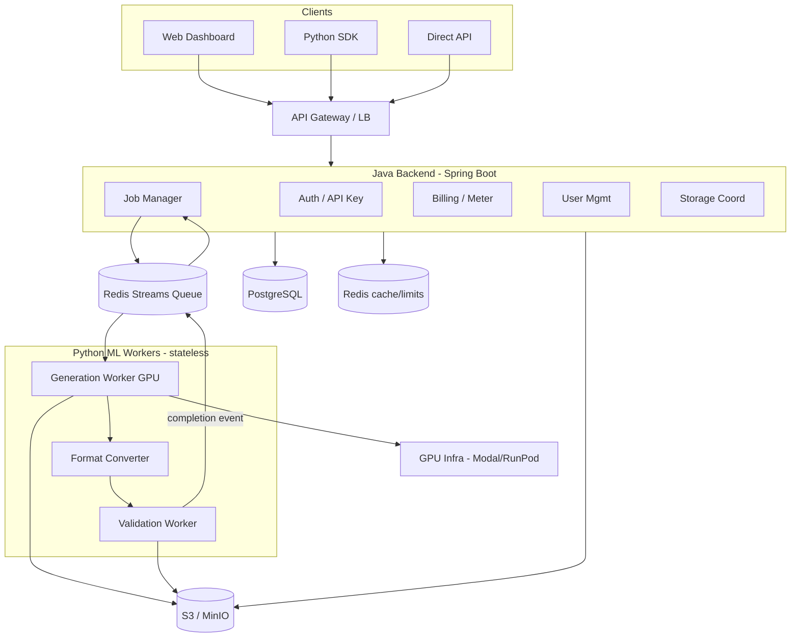
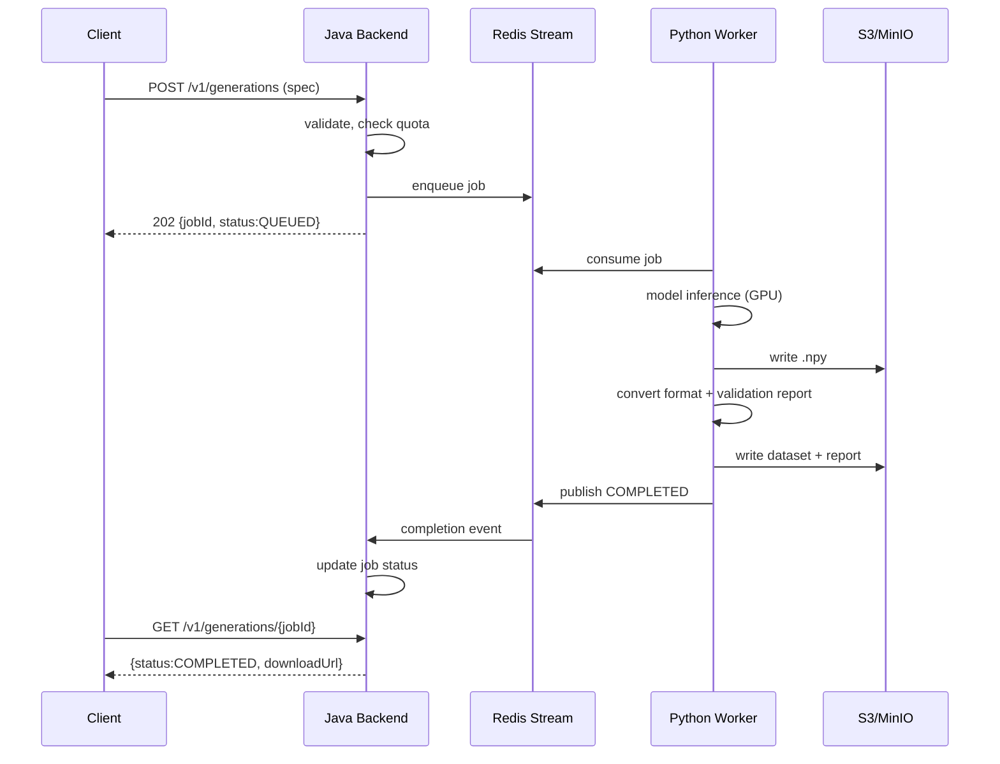
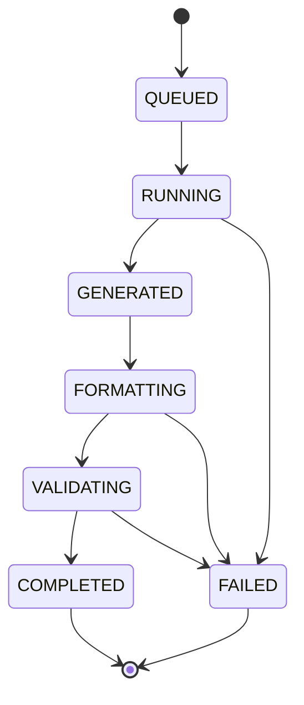
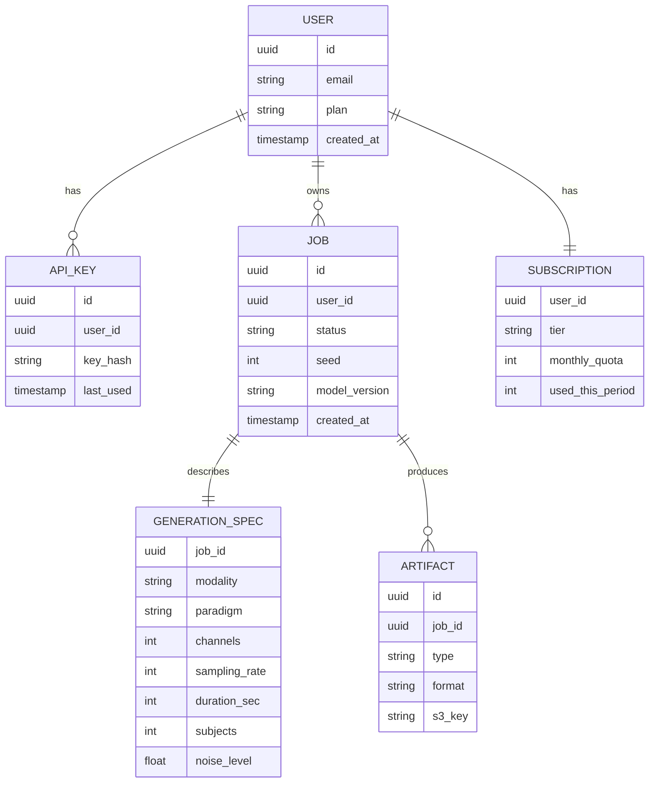

# NeuroSynth - Synthetic Brain Data Platform
## Complete Project Specification & Implementation Plan

> **Document purpose:** Self-contained handoff spec. A developer or AI agent should be able to read this and start implementing without additional context. It captures the vision, goals, market context, requirements, architecture, validation methodology, and a phased implementation plan.

---

## 1. Project Overview

**Working name:** NeuroSynth (placeholder, rename later)

**One-line description:** A research-validated platform that generates synthetic EEG (electroencephalography) data using deep generative models, sold as an API/SaaS to brain-computer interface (BCI) and neurotech companies, with every capability backed by peer-reviewed publications.

**What it does:** Takes user-specified parameters (modality, experimental paradigm, channel count, duration, subject count, noise profile) and generates realistic synthetic EEG recordings in standard neuroscience formats (EDF+, BIDS), each accompanied by an auto-generated statistical validation report.

**The core thesis:** Neural data is expensive and scarce (IRB approval takes 3-12 months and costs $5K-$50K; collecting one EEG dataset costs $10K-$100K+). BCI/ML teams need large training sets. Synthetic data sidesteps privacy/consent issues and scales infinitely - **IF** it demonstrably improves downstream model performance over trivial augmentation.

---

## 2. Goals

### 2.1 Personal / Career Goals (the "why this project")
The owner is a backend (Java) web developer pursuing a long-term pivot into **neuroscience + ML research**. The ultimate trajectory:
- Obtain a **PhD or industrial PhD** at the intersection of neuroscience and AI/ML.
- Eventually work at **ESA** (European Space Agency) on **microgravity effects on the brain**.
- Potentially apply for an **ESA astronaut position** (scientist-astronaut profile; ESA strongly favors PhD-holders with research experience).

This project is a **vehicle** to build: a publication record, domain expertise in EEG+ML, a professional network in neurotech/space-neuroscience, and demonstrated technical+scientific capability.

### 2.2 Business Goals
- Build a **profitable, bootstrapped** business (not necessarily VC-scale) that funds the owner's research and living.
- Realistic 3-year target: **$300K-$1M ARR** via API subscriptions + custom dataset contracts + consulting.
- Primary revenue is NOT the $49/mo academic. It is:
  1. BCI startups paying $1K-$5K/mo for production-grade synthetic training data.
  2. Custom dataset contracts ($10K-$50K each).
  3. Validation-as-a-service ($5K-$20K).

### 2.3 Research / Publication Goals
- Publications serve a **dual purpose**: academic credibility (for PhD/ESA) AND product validation/marketing.
- Target venues: arXiv preprint first, then Frontiers in Neuroscience, Scientific Reports, IEEE TBME, or NeuroImage.
- Each product capability expansion = a new paper + a new revenue stream.
- Publications form the **competitive moat**: competitors must publicly beat your benchmark numbers, not just clone an API.

### 2.4 Success Criteria
| Horizon | Success looks like |
|---------|--------------------|
| 3 months | Go/no-go research validated; preprint drafted; 5-10 beta users |
| 12 months | 1 published paper; $20K-$100K revenue; product-market signal from BCI companies |
| 3 years | 3-5 papers; $300K-$1M ARR; accepted into (or progressing through) a PhD program |

---

## 3. Background & Market Context

### 3.1 Market Validation (researched 2026-06)
- **Synthetic data market:** ~$790M (2026), 31% CAGR → ~$7B by 2034.
- **BCI market:** $2.75B (2026), 14.6% CAGR → $7.14B by 2033. Accelerating (Neuralink scaling, Paradromics' first human implant in June 2026, strong Chinese state investment).
- **Consumer EEG market:** ~$500M (2025), growing fast.
- **Pain point is documented:** Multiple peer-reviewed papers (e.g., Frontiers in Neuroscience 2023 on synthetic EEG for MDD detection) explicitly frame EEG data scarcity as the #1 bottleneck for EEG-based ML.

### 3.2 Competitive Landscape
- Horizontal synthetic-data players (Gretel ~$67M raised, MOSTLY AI, Tonic, SDV) do **tabular/text/image**, NOT neural time-series.
- **No productized "synthetic neural data as a service" competitor exists** as of mid-2026.
- Academic papers exist (GANs/diffusion for EEG) but none are productized.
- **Moat:** domain expertise + published validation benchmarks + standard-format support.

### 3.3 The Critical Risk (must be addressed FIRST)
> **THE go/no-go question:** Does training on (synthetic EEG + real EEG) meaningfully outperform training on (real EEG + standard augmentation: noise injection, time-shift, channel dropout, sliding window)?

- If **yes** → real product, defensible business, publishable result.
- If **no/marginal** → a nice paper at best, no business.

Literature is **encouraging but not conclusive**. This must be validated empirically before building any production infrastructure. This drives the "research-first" implementation order below.

---

## 4. Product Definition

### 4.1 Product Functions
**Core:**
1. **Dataset Generation** - synthetic EEG conditioned on params (modality, paradigm, channels, duration, subjects, noise).
2. **Preset Paradigms** - motor imagery (left/right/feet/tongue), P300 oddball, SSVEP, resting state, sleep stages.
3. **Validation Reports** - auto-generated per dataset: PSD comparison vs real, temporal stats, TSTR score, inter-channel correlation.
4. **Format Export** - EDF+, BrainVision, BIDS-compliant directory, MNE FIF, raw CSV.
5. **Custom Conditioning** - user uploads small real dataset; model adapts to that montage/sampling-rate/demographics.
6. **Dataset Preview** - free short sample + basic metrics before paid full generation.
7. **Batch Generation** - queue large jobs (e.g., 500 synthetic subjects), notify on completion.

**Supporting:** API access (OpenAPI), web dashboard, usage metering/billing, dataset versioning (seed + model-version pinning).

### 4.2 Target Customers (priority order)
1. **BCI startups / neurotech companies** - real budgets, need production training data. (Primary revenue.)
2. **Pharma / CROs** - clinical-trial data augmentation, neuroimaging. (High value, long sales cycle.)
3. **Academic / ML researchers** - low willingness to pay, but volume + credibility + citations + word of mouth. (Freemium funnel.)

### 4.3 Positioning
Not "a synthetic EEG generator utility." Position as **"the data infrastructure layer for brain-computer interfaces."** Start with synthetic generation; expand to preprocessing, benchmark datasets, model validation, and a model zoo over time.

---

## 5. Requirements

### 5.1 Functional Requirements
| ID | Requirement | Priority |
|----|-------------|----------|
| FR-1 | Generate synthetic EEG passing statistical similarity tests vs real (PSD divergence below threshold) | Must |
| FR-2 | User specifies modality, paradigm, channels, duration, sampling rate, subject count | Must |
| FR-3 | Output in >=2 standard formats (EDF+, BIDS) | Must |
| FR-4 | Each dataset includes a validation report (HTML/PDF) | Must |
| FR-5 | REST API with API-key auth for programmatic access | Must |
| FR-6 | Web UI for configuration + job monitoring | Must |
| FR-7 | Free tier (100 samples/mo) + paid tiers via Stripe | Must |
| FR-8 | Async job processing with status polling/webhooks | Must |
| FR-9 | User uploads reference data for custom conditioning | Should |
| FR-10 | Dataset preview (short sample) before full generation | Should |
| FR-11 | Reproducible output given same seed + model version | Should |
| FR-12 | Batch jobs with email/webhook completion notification | Could |

### 5.2 Non-Functional Requirements
| ID | Requirement | Target |
|----|-------------|--------|
| NFR-1 | Generation latency (1 subject, 64ch, 5min EEG) | < 60s |
| NFR-2 | API job-submission response time | < 500ms |
| NFR-3 | System availability | 99.5% |
| NFR-4 | Concurrent job capacity | 20+ jobs |
| NFR-5 | Generated-dataset retention | 30 days |
| NFR-6 | Max single generation request | 100 subjects |

### 5.3 Research / Validation Requirements (gate the whole project)
| ID | Requirement |
|----|-------------|
| RR-1 | Implement TSTR (Train-on-Synthetic, Test-on-Real) benchmark harness |
| RR-2 | Implement baseline: standard augmentation (noise, time-shift, channel dropout, sliding window) |
| RR-3 | Synthetic-augmented training must beat standard-augmentation baseline on a real test set (target: meaningful accuracy/F1 improvement, e.g. >=5-10% relative) |
| RR-4 | Compute distributional fidelity metrics: PSD divergence, ERP preservation, inter-channel correlation, spectral entropy |
| RR-5 | Results reproducible and documented for preprint |

---

## 6. Architecture

### 6.1 Polyglot Rationale (Java + Python)
Owner is a strong Java dev. The standard industry pattern (used at Adyen, Stripe, Netflix) applies: **Java orchestrates business logic; Python does the math.**
- **Java (Spring Boot):** REST API, auth/API-keys, job lifecycle, billing/metering, user management, storage coordination. Use Java 21+ (virtual threads for async job handling).
- **Python:** ML inference (diffusion model), signal processing, format conversion (MNE-Python, pyEDFlib), validation reports. Stateless workers consuming from a queue.
- **Decoupling:** message queue (Redis Streams) between them. Java produces jobs; Python workers consume, write results to object storage, publish completion events. No direct HTTP. Java never touches signal data directly.
- Format conversion lives in Python (better library support: MNE-Python, pyEDFlib, NiBabel).

### 6.2 System Architecture



### 6.3 Job Lifecycle



### 6.4 Job State Machine



### 6.5 Core Data Model



### 6.6 Tech Stack & Key Decisions
| Concern | Choice | Rationale |
|---------|--------|-----------|
| Generative model | Denoising Diffusion (1D U-Net) | Best quality for time-series; well-studied |
| First modality | EEG, 64ch, motor imagery | Best open-data availability |
| Java | Spring Boot, Java 21+ | Owner expertise; virtual threads |
| Python ML | PyTorch, MNE-Python, NumPy, SciPy | Standard neuro-ML ecosystem |
| Queue | Redis Streams | Already need Redis; avoids extra infra |
| DB | PostgreSQL | Standard, JPA support |
| Object storage | MinIO (dev) / S3 (prod) | S3-compatible |
| GPU | Modal.com (serverless) | Scales to 0, pay-per-second, Python-native |
| Deploy | Fly.io (Java) + Modal (Python) | Cheap, good DX, no k8s overhead |
| Experiment tracking | MLflow or Weights & Biases | Reproducibility for papers |
| Billing | Stripe | Standard |

### 6.7 Estimated Running Cost (post-launch)
Fly.io backend ~$7, Postgres ~$7, Upstash Redis ~$5, S3 ~$1, Modal GPU ~$15 (low usage), domain ~$1 → **~$36/month**. Breakeven at ~1 paying customer on the $49 tier.

---

## 7. Datasets (open, for training + validation)
| Dataset | Use | Notes |
|---------|-----|-------|
| **PhysioNet EEG Motor Movement/Imagery (EEGBCI)** | Primary training (Phase 0) | 109 subjects, 64ch, 160Hz, motor imagery; via MNE `eegbci` loader |
| BCI Competition IV (2a/2b) | Benchmark / TSTR | Standard motor-imagery benchmark |
| DEAP | Emotion paradigm (later) | 32 subjects |
| Temple University EEG Corpus (TUH) | Scale-up (later) | 30,000+ sessions |
| OpenNeuro.org (BIDS) | fMRI/EEG expansion (later) | Hundreds of datasets |
| Sleep-EDF (PhysioNet) | Sleep staging (later) | Sleep paradigm |

---

## 8. Validation Methodology (for RR-* and the paper)
1. **TSTR (Train-on-Synthetic, Test-on-Real):** Train a standard EEG classifier (e.g., EEGNet) on synthetic data, test on held-out real data. Compare to TRTR (train-real-test-real) and to standard-augmentation baseline.
2. **Baseline to beat:** real data + standard augmentation (Gaussian noise, time-shift, channel dropout, sliding-window crops).
3. **Distributional fidelity:** Power Spectral Density (Welch) divergence, ERP preservation, inter-channel correlation matrices, spectral entropy, t-SNE/UMAP of real vs synthetic embeddings.
4. **Downstream gain metric:** classification accuracy / F1 uplift when synthetic data augments a small real training set (the commercially relevant scenario).
5. All experiments seeded, tracked (MLflow/W&B), and written up for the preprint.

---

## 9. Implementation Plan (Research-First)

> **Principle:** Do NOT build billing/dashboards/format-converters first. Validate the core ML value proposition (the go/no-go gate) BEFORE building production infrastructure. If RR-3 fails, stop and reconsider before sinking time into the Java backend.

### Phase 0 - Research Validation & Go/No-Go (Weeks 1-4) [PYTHON ONLY]
- [ ] Set up Python ML repo + environment (PyTorch, MNE-Python, NumPy, SciPy, MLflow/W&B).
- [ ] Download + explore EEGBCI (motor imagery, 64ch, 160Hz). Build preprocessing pipeline (filtering, epoching, normalization).
- [ ] Implement EEGNet (or ShallowConvNet) classifier as the downstream evaluator.
- [ ] Implement standard-augmentation **baseline** (RR-2).
- [ ] Implement **1D U-Net denoising diffusion model** for class-conditional EEG generation.
- [ ] Train diffusion model on EEGBCI.
- [ ] Build **TSTR benchmark harness** (RR-1) + distributional fidelity metrics (RR-4).
- [ ] **GO/NO-GO DECISION (RR-3):** Does synthetic-augmented training beat the augmentation baseline by a meaningful margin?

### Phase 1 - Preprint + Minimal API (Weeks 5-10)
- [ ] If GO: write arXiv preprint documenting method + benchmarks (starts publication clock + product credibility).
- [ ] Wrap the model in a minimal **Python FastAPI** service (generate / status / download) - Python-only at this stage for speed.
- [ ] Python format converter: `.npy` → EDF+ and BIDS (MNE-Python, pyEDFlib).
- [ ] Validation worker: auto-generate HTML report (PSD plots, TSTR score, correlation matrices) per dataset.
- [ ] Recruit **5-10 beta users** from BCI communities (Reddit r/BCI, Twitter/X neurotech, OpenBCI forums, Discords). Validate willingness to pay and gather format/paradigm requests.

### Phase 2 - Production Backend (Weeks 11-16) [JAVA ENTERS]
Only build this once Phase 1 shows real usage + willingness to pay.
- [ ] Monorepo: `/backend` (Java/Spring Boot), `/ml` (Python), `/infra` (Docker Compose), `/sdk` (Python client).
- [ ] Spring Boot: REST API, PostgreSQL schema (Section 6.5), Spring Security API-key auth.
- [ ] Job Manager: enqueue to Redis Streams, consume completion events, update status.
- [ ] Refactor Python service into stateless **queue-consuming workers** (generation, formatting, validation).
- [ ] Storage service: presigned S3/MinIO download URLs.
- [ ] Rate limiting + usage metering (Redis).
- [ ] End-to-end flow per Section 6.3.

### Phase 3 - Dashboard, Billing, Launch (Weeks 17-20)
- [ ] Web dashboard (React/Next.js, or Thymeleaf server-rendered for speed): signup, API-key mgmt, new-generation form, job list, downloads, reports.
- [ ] Stripe: free-tier enforcement, paid-tier checkout, usage tracking.
- [ ] Polished **Python SDK** (`pip install neurosynth`): `generate()`, `status()`, `download()`.
- [ ] OpenAPI/Swagger docs (auto-generated from Spring Boot).
- [ ] Deploy: Java on Fly.io, ML workers on Modal.com. Postgres + Upstash Redis + S3.
- [ ] Landing page with example outputs + published validation metrics. Seed 2-3 pre-generated demo datasets.

### Phase 4 - Expansion (post-MVP, ongoing)
- [ ] Peer-reviewed publication (Frontiers / Scientific Reports).
- [ ] Add paradigms (P300, SSVEP, resting state, sleep) - each a potential paper.
- [ ] Custom conditioning (FR-9): fine-tune on user-uploaded reference data (high-margin upsell).
- [ ] Custom dataset contracts + validation-as-a-service offerings (primary revenue).
- [ ] Expand modalities (fMRI/MEG) for pharma market.

---

## 10. Repository Structure (target, by Phase 2)
```
neurosynth/
  backend/                # Java Spring Boot (Phase 2+)
    src/main/java/...      # API, auth, job manager, billing, storage coord
    src/main/resources/
    build.gradle
  ml/                     # Python (Phase 0+)
    models/               # diffusion model, training scripts
    eval/                 # TSTR harness, fidelity metrics, baselines
    workers/              # generation, format converter, validation
    api/                  # FastAPI minimal service (Phase 1)
    requirements.txt
  sdk/                    # Python client library (Phase 3)
  infra/                  # docker-compose (Postgres, Redis, MinIO), deploy configs
  paper/                  # preprint LaTeX/markdown, figures, benchmark results
  README.md
```

---

## 11. Monetization
| Tier | Price | Includes |
|------|-------|----------|
| Free | $0 | 100 synthetic samples/mo, basic EEG only |
| Researcher | $49/mo | 10K samples, all paradigms, API access |
| Lab | $199/mo | Unlimited, custom conditioning, fine-tune on private data |
| Enterprise | Custom | On-prem, dedicated models, compliance docs |

**Real revenue unlocks (beyond subscriptions):** custom dataset contracts ($10K-$50K), validation-as-a-service ($5K-$20K), fine-tuning-as-a-service, consulting.

---

## 12. Risks & Mitigations
| Risk | Mitigation |
|------|-----------|
| Synthetic data doesn't beat augmentation (RR-3 fails) | Validate in Phase 0 BEFORE building infra; pivot if needed |
| Small near-term market (academics won't pay) | Target BCI startups/pharma; freemium for academics as funnel |
| Researchers skeptical of synthetic validity | Publish peer-reviewed benchmarks; ship validation report with every dataset |
| Weak moat / easy to copy | Publication-set benchmarks as moat; first-mover; deepen domain expertise |
| GPU cost | Serverless GPU (Modal, scale-to-0); cache common configs |
| Solo founder bandwidth | Research-first order de-risks; open-source builds community help |

---

## 13. First Steps for the Implementing Agent
1. Create the `ml/` project and environment; verify PyTorch + MNE-Python install and GPU availability.
2. Load EEGBCI via MNE; build preprocessing + epoching pipeline.
3. Implement EEGNet classifier + standard-augmentation baseline (establish baseline accuracy).
4. Implement 1D U-Net diffusion model; train class-conditional generation on EEGBCI.
5. Build TSTR harness + fidelity metrics; produce the **go/no-go report**.
6. **Pause for human review of go/no-go results before proceeding to Phase 1+.**

---

## Open Items / Assumptions
- Name "NeuroSynth" is a placeholder.
- Exact "meaningful improvement" threshold for RR-3 to be finalized after seeing baseline numbers (suggest >=5-10% relative F1/accuracy uplift on small-real-data regime).
- Frontend framework (React vs server-rendered) deferred to Phase 3.
- Phase 0 is the true gate; everything after is conditional on it succeeding.